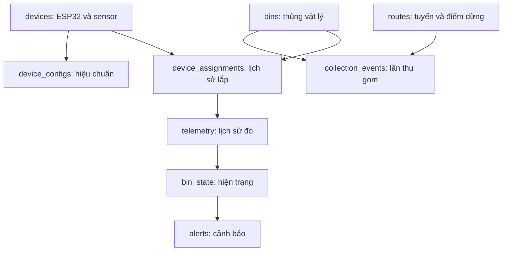

# Bàn giao thiết kế MongoDB — Thu gom rác thông minh

**Phiên bản thiết kế:** 2.0.0 · **Ngày:** 10/10/2026 · **DB:** `smartwaste_v2` · **Giao thức thiết bị:** MQTT JSON v1, giữ nguyên.

**Người bàn giao:** Firmware & Kết nối IoT · **Bên triển khai:** Backend.

Tài liệu này chốt mô hình dữ liệu MongoDB, quy tắc xử lý, cấu hình môi trường và mã tạo DB. Các khối mã có nhãn `FILE` là nội dung file hoàn chỉnh; có thể tách tự động bằng đoạn Python ở mục 8. Không cần phần cứng để tạo DB, chạy seed và kiểm thử validator/index.

Thiết kế kế thừa nghiệp vụ quản lý thùng, nhận mức đầy từ ESP32 qua gateway, cảnh báo, điều phối tuyến và xác nhận thu gom. Các chính sách chưa có số liệu vận hành được chốt thành mặc định triển khai bên dưới; chúng không phải kết quả đã đo ngoài thực địa.

## 1. Quyết định kiến trúc

**Dùng MongoDB làm DB chính và duy nhất trong giai đoạn này. Không cần thêm PostgreSQL chỉ để lưu users hoặc sensors.** Users, thiết bị và lịch sử thu gom vẫn có schema, index duy nhất và transaction trong MongoDB. Backend chịu trách nhiệm kiểm tra tham chiếu giữa collection; MongoDB không tự cung cấp foreign key như DB quan hệ.

| Quyết định | Cách triển khai chốt |
|---|---|
| Phiên bản MongoDB | 8.0 làm baseline; đây không phải tuyên bố phiên bản mới nhất. Ghim image digest sau lần cài đã kiểm thử |
| Môi trường local | MongoDB Community trong Docker, replica set một node `rs0`, cổng chỉ bind loopback |
| Môi trường dùng chung | Atlas hoặc replica set có xác thực, TLS và backup; không đưa cấu hình local không mật khẩu lên Internet |
| Dữ liệu đo | Collection thường `telemetry`; không dùng time-series cho luồng ingest v2 |
| Lý do chọn collection thường | Cần unique key chống trùng, validator và cập nhật trạng thái xử lý. Time-series có hạn chế khác collection thường [R3] |
| Khóa tài liệu | Chuỗi định danh ổn định; `_id` của telemetry chính là `message_id` |
| Thùng và thiết bị | `bins` là thùng vật lý; `devices` là ESP32; `device_assignments` là lịch sử gắn thiết bị |
| Sensor | Mảng nhỏ, có giới hạn trong `devices.sensors`; lịch sử hiệu chuẩn ở `device_configs` |
| Hiện trạng | `bin_state` là projection có thể tái dựng; không nhúng lịch sử telemetry vào thùng |
| Cảnh báo | `alerts` lưu một vòng đời cảnh báo; `audit_logs` lưu chuyển trạng thái và thao tác |
| Retention | Không TTL telemetry, collection_events, audit_logs ở v2. Chỉ log ingest lỗi có TTL 30 ngày từ lần gặp cuối |
| Dữ liệu thiếu | Dùng BSON/JSON `null`; không thay bằng 0, chuỗi rỗng hoặc chuỗi `"null"` |
| Đơn vị | mm, mV, %, kg, mét, giây; thời gian DB là BSON Date UTC |
| Quy mô tính toán ban đầu | 200 thùng × 4 báo cáo/ngày = 800 bản ghi/ngày, khoảng 292.000/năm, chưa tính sự kiện. Đây là cơ sở lập kế hoạch, không phải benchmark |

Không cần sharding, Redis hay DB thứ hai để bắt đầu. Đo dung lượng BSON/index, tốc độ ingest và truy vấn thực tế trước khi mở rộng. PostgreSQL chỉ nên được đánh giá lại khi phát sinh nghiệp vụ quan hệ phức tạp, kế toán hoặc yêu cầu báo cáo độc lập đủ lớn để bù chi phí đồng bộ hai DB.

## 2. Phạm vi và quy tắc nghiệp vụ

### 2.1. Thiết bị và phép đo

- ESP32 node đo HC-SR04; gateway chuyển thành JSON và gửi MQTT. Luồng nguyên mẫu là LoRa P2P → gateway → Wi-Fi/MQTT, không mặc nhiên là LoRaWAN.
- Chu kỳ mặc định: đo 60 giây, báo cáo định kỳ 21.600 giây; có báo cáo sự kiện ngoài lịch.
- Firmware xác nhận đầy sau **2 lần đo hợp lệ liên tiếp >80%**; xác nhận hết đầy sau **2 lần hợp lệ liên tiếp ≤70%**. Mẫu lỗi làm ngắt chuỗi xác nhận, không tự đóng cảnh báo.
- `alarm_active=null` sau khởi động nghĩa là chưa biết; giữ cảnh báo trước đó của cùng assignment. Không diễn giải null thành false.
- `quality != ok` thì `fill_pct` và `distance_mm` phải null. Backend giữ `last_good` nhưng hiển thị kèm tuổi mẫu và lỗi mới nhất.
- `battery_mv=null` là hợp lệ nếu phần cứng chưa đo pin. Không tạo cảnh báo pin yếu từ giá trị null; v2 chưa có loại cảnh báo pin yếu.
- Loại rác và vị trí là dữ liệu quản lý. Sensor siêu âm không tự nhận diện loại rác, không đo kg và không cung cấp GPS.
- Cấu hình trong DB là hồ sơ hiệu chuẩn. Firmware v1 chưa có lệnh MQTT cập nhật cấu hình từ xa; sửa DB không làm thay đổi ESP32.

### 2.2. Chính sách vận hành mặc định

| Chính sách | Giá trị và hành vi |
|---|---|
| Tuổi mẫu còn mới cho bản đồ | `sampled_at` trong 8 giờ gần nhất, không ở tương lai; chỉ áp dụng khi `time_quality=gateway_estimated` |
| Thiết bị mất liên lạc | Sau 8 giờ không có **message_id mới** được chấp nhận trong assignment hiện tại; khi chưa có dữ liệu, tính từ lúc lắp |
| Gateway heartbeat | Mỗi 60 giây; đánh giá mất kết nối sau 150 giây không có heartbeat mới hoặc khi nhận LWT offline |
| Thời gian sai | Nếu timestamp âm, vượt tương lai quá 5 phút so với server hoặc công thức tuổi mẫu sai: từ chối ingest và ghi log lỗi. Đồng bộ NTP cho server |
| Thời gian sát lúc đổi thiết bị | Mặc định vùng không chắc chắn ±120 giây quanh mốc lắp/tháo: không tự gán thùng; đánh dấu `ambiguous_time` để xử lý |
| Timestamp không đồng bộ | Lưu raw với thời gian đo null; không dùng `received_at` để giả làm thời gian đo. Không tự gán lịch sử thùng khi thiếu bằng chứng thời gian |
| Retry worker | Lease 60 giây; retry 5, 10, 20… tối đa 300 giây, thêm jitter; quá 10 lần chuyển blocked và báo vận hành |
| Giới hạn tuyến | Tối đa 200 điểm dừng, mỗi thùng xuất hiện tối đa một lần trong một tuyến |
| Xóa dữ liệu quản lý | Ngừng sử dụng bằng status/lifecycle; không xóa thùng, thiết bị hay user đã có lịch sử tham chiếu |

Mốc 8 giờ phù hợp chu kỳ 6 giờ đang dùng. Nếu đổi chu kỳ báo cáo phải đổi cấu hình Backend tương ứng. Đây là cấu hình dịch vụ, không phải thêm trường tùy ý vào schema. Gateway online không chứng minh tất cả node đều đang hoạt động.

## 3. Mô hình dữ liệu



Mũi tên thể hiện quan hệ nghiệp vụ/tham chiếu, không phải foreign key do MongoDB cưỡng chế. Users, gateways và log vận hành được mô tả đầy đủ trong bảng sau.

### 3.1. Danh mục 14 collection

| Collection | Một document đại diện cho | Khóa/tham chiếu chính | Nguồn ghi |
|---|---|---|---|
| `users` | Một tài khoản Web/App | `_id`; email chuẩn hóa duy nhất | API quản trị/xác thực |
| `bins` | Một thùng rác vật lý | `_id=WB-001`, code duy nhất | API quản lý thùng |
| `devices` | Một ESP32 node | `_id=bin-001`; gateway_ids → gateways | API provisioning |
| `device_assignments` | Một khoảng gắn ESP32 vào thùng | device_id → devices; bin_id → bins | API lắp/thay/tháo |
| `gateways` | Một gateway đã được cấp phép | `_id=gw-001` | Provisioning + consumer status |
| `device_configs` | Một phiên bản hiệu chuẩn của node | device_id + config_rev duy nhất | Firmware/provisioning qua API |
| `telemetry` | Một báo cáo duy nhất từ node | `_id=message_id`; assignment_id có thể null | MQTT ingest |
| `bin_state` | Hiện trạng một thùng | `_id=bins._id` | Worker projection |
| `alerts` | Một lần mở → xác nhận → giải quyết cảnh báo | scope_type, scope_id, type | Worker/scheduler/API |
| `collection_events` | Một lần thu gom được nhân viên xác nhận | worker_id; bin_id; route_id tùy chọn | API xác nhận thu gom |
| `routes` | Một tuyến trong một ngày phục vụ | assigned_worker_id; stops[].bin_id | API điều phối |
| `audit_logs` | Một thao tác/chuyển trạng thái nghiệp vụ | entity_type + entity_id; event_key duy nhất | Backend trong transaction |
| `ingest_rejections` | Nhóm các lần nhận payload lỗi giống nhau | `_id=SHA-256(topic + payload bytes)` | MQTT ingest |
| `schema_migrations` | Một migration DB đã áp dụng | `_id=schema-v2_0_0` | Script triển khai |

**Điểm dễ nhầm:** `bin-001` là ID thiết bị của giao thức đã bàn giao, không phải ID thùng vật lý. `WB-001` mới là thùng. Không đổi nghĩa `device_id` trong firmware. `sensors.sensor_id` chỉ cần duy nhất trong một device; khóa tham chiếu đầy đủ là `(device_id, sensor_id)`.

### 3.2. Embed hay reference

Embed `devices.sensors` (tối đa 8), `routes.stops` (tối đa 200), `bin_state.last_good` (một mẫu): dữ liệu có giới hạn, thường đọc cùng tài liệu cha. Reference telemetry, assignment, cấu hình phiên bản, cảnh báo, thu gom và audit vì tăng theo thời gian hoặc có vòng đời riêng. Không tạo mảng `telemetry[]` tăng vô hạn trong bins/devices.

`device_assignments` dùng khoảng nửa mở **[installed_at, removed_at)**; removed_at null là chưa tháo. Giữ lịch sử để một gói gửi chậm không bị gán nhầm sang thùng mới. Chỉ `active=true` xác định assignment hiện tại, không dựa vào số thứ tự document.

### 3.3. Quy ước schema

- Tất cả trường xuất hiện trong định nghĩa object của script đều bắt buộc; trường có thể thiếu thông tin phải được ghi rõ null. `additionalProperties:false` ở document và object lồng nhau.
- Chuỗi ID chỉ gồm chữ, số, `:`, `_`, `-`, dài tối đa 80 và bắt đầu bằng chữ/số. ID thiết bị và gateway có pattern hẹp hơn. UUID dạng chuỗi có thể dùng cho route, alert, event, user.
- Các trường nguyên dùng BSON Int32 hoặc Int64; epoch milliseconds và bộ đếm uint32 nên dùng Int64. Không lưu uint32 vào Int32 khi vượt 2.147.483.647. Với mongosh dùng `NumberInt`, `NumberLong`; driver phải chuyển số nguyên đúng kiểu.
- `created_at`, `updated_at`, `received_at` là thời gian UTC phía Backend; API trả ISO-8601 có `Z`. `service_date` là ngày lịch địa phương `Asia/Ho_Chi_Minh`, không phải UTC timestamp.
- GeoJSON `coordinates=[longitude, latitude]`; API kiểm tra kinh độ [-180,180], vĩ độ [-90,90], số hữu hạn. `location=null` được phép lúc provision; thùng field phải có tọa độ trước khi đưa vào bản đồ/tối ưu tuyến.
- Giá trị số đầu vào phải hữu hạn; API từ chối NaN/Infinity, khóa JSON trùng nhau và trường lạ trước khi gọi DB.
- MongoDB `$jsonSchema` dùng biến thể Draft 4 với `bsonType`; không chép nguyên schema MQTT Draft 2020-12 làm validator DB [R4].
- `_id` đã có unique index mặc định. 30 index trong script là index bổ sung, không bao gồm 14 index `_id`.

### 3.4. Ràng buộc DB và ràng buộc Backend

| Quy tắc | DB cưỡng chế | Backend bắt buộc làm thêm |
|---|---|---|
| Email | Unique + dạng email cơ bản + chữ thường | Trim, chuẩn hóa theo chính sách ASCII của dự án, kiểm tra hợp lệ, xác minh nếu áp dụng |
| User hoạt động | Có password_hash dạng chuỗi | Hash mật khẩu bằng thư viện phù hợp; không chấp nhận plaintext; kiểm tra role và trạng thái khi đăng nhập |
| Một node/thùng đang gắn | Partial unique index khi active=true [R5] | Kiểm tra tham chiếu, không chồng lấn khoảng lịch sử, cập nhật đồng bộ trong transaction |
| Cấu hình hiệu chuẩn | empty > full; report ≥ sample; revision duy nhất | Sensor thuộc đúng device; không sửa nội dung revision đã verified; cấp revision mới khi đổi thông số |
| Bản tin | Unique ID và unique(device,boot,seq); trường, kiểu, khoảng giá trị | Kiểm tra ID được ghép đúng từ device/boot/seq, ACL, hash và quyền gateway |
| Mẫu lỗi | fill/distance null; mẫu ok có ít nhất 5 mẫu hợp lệ | Không cập nhật last_good từ mẫu lỗi |
| Quan hệ timestamp | Công thức sampled_ms; Date tương ứng epoch | Kiểm tra lệch giờ/tương lai, ánh xạ assignment theo khoảng thời gian |
| Cảnh báo mở | Unique(scope,type) với active=true; trạng thái cơ bản | Đúng sự kiện, phân quyền ack/resolve, ghi audit; chuyển trạng thái hợp lệ |
| Thu gom | Idempotency key duy nhất; mỗi route/stop chỉ có một event | Worker có quyền, route/stop khớp bin, nội dung request trùng hash khi retry |
| Tuyến | Kiểu dữ liệu, số điểm, enum | Ngày lịch thật; stop_order 1..N không lặp; bin không lặp; trạng thái từng stop khớp event |
| Tính toàn vẹn tham chiếu | Không có foreign key | Kiểm tra mọi ID được tham chiếu; transaction, soft delete, kiểm tra đối soát định kỳ |

## 4. Hợp đồng lưu dữ liệu IoT và xử lý đồng thời

### 4.1. MQTT và ACK

| Topic | Hướng | Quy ước |
|---|---|---|
| `smartwaste/v1/devices/{device_id}/telemetry` | Gateway → Backend | Publish QoS 0, retain=false, payload ≤1.200 byte |
| `smartwaste/v1/gateways/{gateway_id}/ack` | Backend → gateway | Publish QoS 1, retain=false |
| `smartwaste/v1/gateways/{gateway_id}/status` | Gateway → Backend | Online/heartbeat retained; LWT offline retained |

Backend subscribe `smartwaste/v1/devices/+/telemetry` và `smartwaste/v1/gateways/+/status`. Xác thực tại broker và ACL theo gateway/device. Trường gateway_id tự khai trong payload không đủ chứng minh nguồn gửi. MQTT subscriber thông thường không nhận username của publisher; dựa vào ACL đã cấp hoặc metadata tin cậy từ broker, không giả định thư viện tự cung cấp identity đó.

ACK sau khi DB xác nhận lưu bền vững (`w=majority`, journal; nếu timeout/không rõ kết quả thì không gửi ACK thành công):

```json
{"schema_version":1,"message_id":"bin-001-00000001-00000001","status":"stored"}
```

Retry có cùng nội dung node đã được lưu trả `status="duplicate"`. ACK gửi về gateway của lần nhận hiện tại, kể cả document raw đầu tiên được lưu từ gateway khác được cho phép. Không gửi stored/duplicate khi validation lỗi, ID trùng nhưng nội dung khác, DB lỗi hoặc chưa rõ kết quả write. Không đợi ACK MQTT thành công ngay trong callback network làm nghẽn vòng lặp.

DB v2 không đổi payload MQTT. Document telemetry lưu các trường nguồn ở cấp đầu, thêm metadata DB. Trường nguyên, bool, null phải đúng kiểu; ví dụ JSON string `"85"` không phải số.

### 4.2. Chuẩn hóa một telemetry document

1. Từ chối retained telemetry; kiểm tra kích thước, JSON, schema_version=1, toàn bộ trường nguồn ở bảng từ điển và quan hệ chéo ở script.
2. So topic với device_id; ghép lại `message_id = device_id + '-' + boot_id_hex8 + '-' + seq_hex8` (hex chữ thường, đủ 8 ký tự mỗi số).
3. Kiểm tra devices.enabled, gateway tồn tại/enabled và gateway_id trong devices.gateway_ids. Không dùng danh sách tự khai trong request để mở quyền.
4. Tính hash node theo thuật toán mục 4.3. `_id=message_id`; `db_schema_version=2`; `received_at=UTC server now` của lần lưu đầu tiên.
5. `sampled_at` và `gateway_received_at` chuyển từ epoch milliseconds sang BSON Date, hoặc null khi unsynced. Giữ nguyên các trường `*_ms` nguồn để đối chiếu.
6. Ánh xạ assignment bằng `sampled_at`, bỏ các mẫu nằm trong vùng ±120 giây quanh mốc thay thế. Khớp đúng một khoảng → mapping_status=resolved, bin_id và assignment_id có giá trị. Không khớp → unassigned; thiếu thời gian/không chắc chắn/nhiều khoảng → ambiguous_time, cả hai ID null. Không tự gán theo received_at.
7. Khởi tạo `processing={state:'pending',attempts:0,lease_owner:null,lease_until:null,next_retry_at:now,processed_at:null,last_error:null}`.
8. Lưu bằng `$setOnInsert`, không ghi đè raw khi retry. Với hai consumer chạy đồng thời, bắt cả DuplicateKey; đọc lại `_id` với readConcern majority rồi so content_hash. Cùng hash → duplicate; khác hash → ingest_rejections, không ACK thành công.
9. ACK ngay sau bước lưu raw được xác nhận. Worker xử lý projection độc lập; lỗi worker không làm mất raw hay giữ queue gateway vô hạn.

**Unknown config_rev:** payload đúng giao thức và thiết bị đã được cấp phép vẫn lưu raw + ACK; worker đánh dấu blocked đến khi bổ sung cấu hình verified. Không tự tạo một cấu hình hiệu chuẩn giả từ fill_pct. `devices.applied_config_rev` chỉ được cập nhật khi đã đối chiếu firmware/registry; số revision được gửi lên tự nó không xác nhận thông số đã đúng.

**Không gán được thùng:** raw vẫn được lưu và ACK nếu hợp lệ. Worker chuyển blocked, không sửa bin_state. API đối soát có thể bổ sung mapping sau khi kiểm chứng nhật ký lắp đặt, ghi audit và đặt lại pending. Không sửa payload nguồn/hash. Đối với dữ liệu unsynced, người vận hành chỉ được gán thủ công khi có bằng chứng assignment; last_good.sampled_at vẫn null và không được hiển thị fresh.

### 4.3. Hash chống trùng tương thích bản bàn giao firmware v1

Hash chỉ bao gồm nội dung node. Loại khỏi hash: gateway_id, gateway_fw, rssi_dbm, snr_db, gateway_boot_id, gateway_rx_uptime_ms, gateway_received_at_ms, sampled_at_ms, time_quality, sample_age_at_rx_s. Các trường transport có thể khác khi cùng báo cáo được phát lại; không coi đó là phép đo mới.

Mã Python tham chiếu sau chỉ chạy trên **payload nguồn đã validate**, trước khi thêm trường DB:

```python
import hashlib
import json

TRANSPORT_FIELDS = {
    'gateway_id', 'gateway_fw', 'rssi_dbm', 'snr_db', 'gateway_boot_id',
    'gateway_rx_uptime_ms', 'gateway_received_at_ms', 'sampled_at_ms',
    'time_quality', 'sample_age_at_rx_s',
}

def node_content_hash(payload):
    core = {k: v for k, v in payload.items() if k not in TRANSPORT_FIELDS}
    if core['fill_pct'] is not None:
        # Firmware emits tenths. Validate that fill_pct has at most one decimal.
        core['fill_pct'] = round(core['fill_pct'] * 10)
    encoded = json.dumps(core, sort_keys=True, separators=(',', ':'),
                         ensure_ascii=True, allow_nan=False).encode('utf-8')
    return hashlib.sha256(encoded).hexdigest()
```

Backend dùng ngôn ngữ khác phải tạo chính xác cùng JSON: key sort theo thứ tự từ điển ASCII, không khoảng trắng, bool/null đúng JSON, các giá trị nguyên xuất ra dạng nguyên, fill_pct đổi sang số nguyên phần mười. Không hash trực tiếp chuỗi JSON nhận được vì thứ tự key và cách viết 85/85.0 có thể khác. Không đưa received_at/processing/bin_id vào hash. Từ chối fill_pct có độ chính xác lớn hơn một chữ số thập phân trước khi hash để tránh gộp hai nội dung khác nhau.

### 4.4. Worker projection và cảnh báo

**State machine:** pending → applied (đã cập nhật hiện trạng), ignored (đã lưu lịch sử nhưng cũ/không còn assignment hiện tại), blocked (cần xử lý lỗi hoặc thiếu metadata). pending + lease đang còn hạn nghĩa là có worker đang xử lý; không cần enum processing riêng.

Worker claim bằng findOneAndUpdate một document pending, next_retry_at≤now và lease_until null hoặc hết hạn; set lease_owner, lease_until=now+60s, tăng attempts. Worker khác chỉ claim sau hết lease. Chạy transaction ngắn với snapshot readConcern, majority writeConcern; kiểm tra lại lease còn thuộc mình trước khi commit. Driver retry transaction theo lỗi transient, không gọi dịch vụ bên ngoài bên trong transaction.

Trong transaction:

1. Đọc lại telemetry, assignment, bin_state và config; kiểm tra assignment_version. Mapping thuộc assignment đã tháo chỉ đi vào lịch sử, đánh dấu ignored; không tác động trạng thái hiện tại.
2. Với cùng device và assignment, so thứ tự **(boot_id, seq)** theo số nguyên. Tuple lớn hơn mới được cập nhật latest; tuple bằng/nhỏ hơn thì ignored. Không dùng received_at hoặc thứ tự callback MQTT để quyết định mới/cũ.
3. Cập nhật latest_quality/message_id/boot/seq và các thời gian. last_contact_at chỉ tăng theo thời điểm nhận **message_id mới** của assignment hiện tại; retry cùng ID không tăng. Mẫu nguồn cũ được giao mới có thể chứng minh đường giao tiếp đã hoạt động, nhưng không làm tuổi mẫu fresh hơn.
4. Nếu quality=ok, cập nhật last_good. Mẫu lỗi giữ last_good cũ. `alarm_active` chỉ thay khi nguồn là bool; null giữ giá trị đã biết trong cùng assignment.
5. Theo trạng thái được chấp nhận: true mở/giữ cảnh báo full, false giải quyết full; mẫu quality lỗi mở sensor_fault, mẫu ok giải quyết sensor_fault. Có thể phục hồi cảnh báo từ bản periodic có alarm_active=true, không chỉ dựa vào reason=full.
6. Cập nhật telemetry.processing thành applied/ignored cùng processed_at, giải phóng lease; thêm audit khi có chuyển trạng thái thật. Dùng event_key ổn định, ví dụ `alert_open:{alert_id}` và `alert_resolve:{alert_id}`.
7. Commit toàn bộ. Nếu worker chết trước commit, lease hết hạn cho phép chạy lại; nếu đã commit, state không còn pending nên không tạo cảnh báo đôi.

Có thể chạy nhiều worker nhưng cần transaction/write conflict retry để không ghi đè trạng thái mới bằng một snapshot cũ. Lấy trạng thái và assignment trong cùng transaction; thao tác đổi thiết bị cũng phải ghi bin_state để cạnh tranh được phát hiện. Không chỉ đọc rồi replaceOne ngoài transaction.

**Xóa NVS/reset bộ đếm:** firmware tăng boot_id qua các cold boot. Nếu xóa NVS, phải provision ID thiết bị mới hoặc có migration namespace riêng. Không reset latest_boot_id về 0 để chấp nhận lại cùng ID: unique message_id có thể va chạm dữ liệu cũ. Nếu bộ đếm đạt giới hạn cũng cần reprovision trước khi quay vòng.

### 4.5. Trạng thái gateway

Online/heartbeat có: schema_version, gateway_id, state, gateway_fw, gateway_boot_id, uptime_s, reported_at_ms, queue_depth, queue_capacity=32, invalid_packets, queue_full_events, storage_errors, wifi_rssi_dbm. Offline LWT chỉ cần schema_version, gateway_id, state=offline.

Map gateway_fw→firmware_version, gateway_boot_id→boot_id, reported_at_ms→status_reported_at Date. Cập nhật các counter và last_received_at của heartbeat mới được chấp nhận. Với offline chỉ cập nhật status/updated_at và mở gateway_offline; không xóa counter hoặc phiên đang biết. Retained online từ phiên cũ không đủ để đánh dấu online: kiểm tra reported_at và độ mới; khi timestamp null chỉ heartbeat live không retained mới được dùng làm bằng chứng liveness. Tránh cho bản retained cũ ghi đè số liệu phiên mới. Scheduler quét mỗi 30 giây để tính ngưỡng 150 giây.

### 4.6. Vòng đời cảnh báo

| Loại | Scope | Mở khi | Giải quyết tự động khi |
|---|---|---|---|
| full | bin | Mẫu mới của assignment hiện tại có alarm_active=true | Mẫu mới xác nhận alarm_active=false |
| sensor_fault | device | Mẫu mới quality khác ok | Mẫu mới quality=ok |
| device_stale | device | Quá ngưỡng 8 giờ không nhận ID mới | Nhận ID mới hợp lệ |
| gateway_offline | gateway | LWT offline hoặc quá 150 giây | Heartbeat mới hợp lệ |

`acknowledged` là người vận hành đã nhận việc; cảnh báo vẫn active=true. Chỉ resolved mới active=false, có resolved_at và resolve_reason. Một cảnh báo có thể đi thẳng open→resolved nếu điều kiện tự hết. Khi tháo thiết bị, đóng cảnh báo gắn với assignment cũ bằng lý do `assignment_changed`, ghi audit và đặt hiện trạng thùng về chưa biết; không ghi giả một lần thu gom.

## 5. Nghiệp vụ API và transaction

### 5.1. Lắp, tháo hoặc thay thiết bị

API chỉ cho admin thao tác. Dùng transaction để: kiểm tra bins/devices/gateway/config; đóng assignment cũ với removed_at và removed_by; tăng bins.assignment_version; tạo assignment mới; cập nhật lifecycle; reset bin_state sang device/assignment mới với tuple 0, last_good/null, alarm_active/null; xử lý cảnh báo cũ và ghi audit. Tháo không lắp mới thì bin_state.device_id/assignment_id=null.

Khoảng thời gian lắp/tháo không được chồng lấn với lịch sử của cả device và bin. Với thao tác bình thường chỉ dùng thời gian hiện tại; không cho endpoint thường xuyên sửa lùi lịch sử. Sửa lịch sử cần quy trình đối soát riêng vì có thể phải remap telemetry và tái dựng projection. Unique index chỉ bảo đảm active không trùng, không kiểm tra được giao nhau của mọi khoảng đã đóng.

Khi đổi revision hiệu chuẩn trên cùng thiết bị: thêm device_configs mới, xác minh thông số trên firmware, đổi applied_config_rev; không ghi đè revision cũ. Reset last_good/đánh dấu lại hiện trạng theo quy trình bảo trì nếu việc đổi cách đo khiến giá trị cũ không còn so sánh được; ghi audit và chờ mẫu mới, không sửa raw quá khứ.

### 5.2. Xác nhận thu gom

Request phải có Idempotency-Key do client sinh cho một hành động, dùng lại khi retry. Backend tính request_hash từ JSON request đã chuẩn hóa (không gồm recorded_at do server tạo). Key trùng + cùng hash → trả event đã lưu; key trùng + hash khác → HTTP 409. Một route/stop chỉ có một collection_event.

Trong transaction: xác thực collector/admin; kiểm tra bin tồn tại; nếu có route thì worker được phân công, route đang in_progress, stop khớp bin và chưa hoàn tất; insert collection_events; cập nhật stops[].status=collected, completed_at và collection_event_id; nếu tất cả điểm collected/skipped thì hoàn tất route; ghi audit. Chỉ cập nhật stop tương ứng, không ghi đè cả tuyến từ dữ liệu client cũ.

completed_at là thời gian thực hiện do client gửi và được kiểm tra không ở tương lai quá 5 phút, không trước thời điểm bắt đầu tuyến; recorded_at là server now. Cho phép ghi nhận thu gom ngoài tuyến với route_id/stop_order=null. API phải ghi nhận rõ nguồn weight_source=scale/manual; không có cân/nhập liệu thì measured_weight_kg=null, weight_source=unknown. Không suy kg từ fill_pct.

Xác nhận thu gom **không tự sửa telemetry hoặc đặt bin_state.fill về 0**, không tự đóng full như thể sensor đã xác nhận. UI có thể hiển thị “đã thu gom, chờ cảm biến xác nhận” dựa vào event gần nhất; full đóng khi nhận alarm_active=false hoặc quyết định thủ công có audit và lý do.

### 5.3. Tuyến và đo hiệu quả

Trạng thái tuyến: planned→assigned→in_progress→completed; có thể cancelled trước khi completed. Khi bắt đầu phải có collector active, điểm có tọa độ và depot hợp lệ. Mỗi stop: pending→collected hoặc skipped; skipped phải có lý do và completed_at, collection_event_id=null; collected phải có event khớp route/stop/bin. completed route không còn pending, phải có started_at/completed_at hợp lý. Backend kiểm tra các quy tắc này vì validator không thay thế state machine.

Mỗi stop lưu location_snapshot và planned_fill_pct/planned_sampled_at tại lúc lập tuyến; việc sửa vị trí bins về sau không làm biến đổi báo cáo tuyến cũ. planned_distance_m là ước tính, actual_distance_m là quãng đường thực tế có nguồn (odometer/gps/manual). baseline_distance_m và baseline_method phải cùng có hoặc cùng null ở tầng API.

Tỷ lệ giảm quãng đường chỉ tính với cùng phạm vi điểm dừng/điều kiện có thể so sánh, baseline>0 và actual có dữ liệu: `(baseline - actual) / baseline × 100%`. Giá trị âm nghĩa là tăng quãng đường. Không đổi planned thành actual, không gán quãng đường thiếu thành 0.

### 5.4. Danh sách endpoint tối thiểu

Đây là hợp đồng nghiệp vụ đề xuất để Backend triển khai; tài liệu DB không bao gồm server HTTP đã chạy.

| Endpoint | Quyền | Collection/chức năng |
|---|---|---|
| POST /auth/login | Public có giới hạn tần suất | users; trả token theo chuẩn Backend |
| GET /bins | Người dùng active | bins + bin_state; filter ward/type/full/fresh; bỏ lab mặc định |
| POST/PATCH /bins | admin | Metadata, tọa độ; không nhận telemetry từ client |
| POST /devices, POST /gateways | admin | Provision registry trước kết nối |
| POST /bins/{id}/assignments | admin | Transaction lắp/thay; trả assignment/version mới |
| POST /devices/{id}/configs | admin | Tạo revision; xác nhận verified qua quy trình provisioning |
| GET /bins/{id}/telemetry | admin, dispatcher | Lịch sử phân trang cursor, khoảng thời gian bắt buộc |
| GET /alerts | admin, dispatcher, collector được phân công | Lọc scope/type/status, phân trang |
| POST /alerts/{id}/ack | admin, dispatcher hoặc collector có quyền | Cập nhật acknowledgment + audit |
| POST /routes | admin, dispatcher | Lập tuyến từ thùng/điểm hợp lệ |
| PATCH /routes/{id}/status | Điều phối hoặc collector được giao | Chuyển trạng thái hợp lệ |
| POST /collection-events | collector được giao, admin | Idempotency-Key + transaction |
| GET /reports/collections | admin, dispatcher | Lượt, kg biết/không biết, nhóm loại rác |
| GET /reports/routes | admin, dispatcher | Planned/actual/baseline tách biệt |

HTTP: 200/201 thành công; 400/422 input sai; 401 chưa xác thực; 403 thiếu quyền; 404 ID không tồn tại; 409 conflict/idempotency/nhiều assignment. Error chuẩn `{code,message,request_id,details}`. Không trả password_hash, thông tin DB/broker hay secrets ra API. Không chấp nhận MongoDB operator từ filter do client gửi; whitelist trường/kiểu, giới hạn page_size≤100.

## 6. Cài đặt MongoDB từ đầu

### 6.1. Chuẩn bị công cụ

**Windows:** bật virtualization trong BIOS/UEFI nếu Docker yêu cầu; cài WSL2 và Docker Desktop theo hướng dẫn chính thức [R1a], dùng Linux containers. Mở Docker Desktop, đợi Engine running. Cài MongoDB Shell (mongosh) và tùy chọn Compass từ trang MongoDB [R1b, R1c]. Đóng/mở terminal sau khi thêm PATH.

**macOS:** cài Docker Desktop đúng Apple Silicon/Intel, mongosh và Compass tương ứng kiến trúc. **Linux:** cài Docker Engine + Compose plugin theo tài liệu đúng distro [R1d], bảo đảm daemon hoạt động và tài khoản có quyền chạy Docker. Không cần cài thêm MongoDB Server trực tiếp lên host nếu đã dùng container.

MongoDB Server là DB; mongosh là CLI kết nối DB; Compass là GUI. Chỉ cài Compass không tạo ra server MongoDB. Phần hướng dẫn dưới dùng mongosh trên máy host; không giả định image slim có mongosh bên trong.

Trong PowerShell/Terminal chạy riêng từng dòng:

```text
docker version
docker compose version
mongosh --version
```

Máy x86 cần CPU hỗ trợ yêu cầu của MongoDB 8.0; nếu gặp illegal instruction hãy kiểm tra CPU/AVX, không hạ xuống bản MongoDB hết hỗ trợ để vượt lỗi [R1]. Dung lượng/RAM local phụ thuộc Docker và dữ liệu; có thể khởi đầu bằng 2 CPU/4 GB RAM cho container lab rồi đo, không coi đó là sizing production.

### 6.2. Tạo thư mục và tách các file

Tạo thư mục mới `smartwaste-db`, lưu Markdown này trong đó. Tách 5 khối FILE ở mục 9 thành:

```text
compose.yaml
01_schema.js
02_seed_lab.js
03_smoke_test.js
04_queries.js
```

Có thể dùng script trích xuất mục 8. Mở terminal tại thư mục chứa compose.yaml. File YAML dùng dấu cách, không dùng tab.

### 6.3. Chạy container local

```text
docker compose pull
docker compose up -d
docker compose ps
docker compose logs --tail=100 mongo
```

Image baseline: `mongodb/mongodb-community-server:8.0-ubi9-slim` của MongoDB [R1, R1e]. Tag theo nhánh có thể được cập nhật patch; sau khi chạy ổn, ghi lại digest và thay giá trị image trong compose bằng `mongodb/mongodb-community-server@sha256:...` từ chính máy đã pull. Không dùng chuỗi digest minh họa như giá trị thật.

```text
docker image inspect mongodb/mongodb-community-server:8.0-ubi9-slim --format '{{index .RepoDigests 0}}'
```

Compose bind `127.0.0.1:27017`, dùng named volume để giữ dữ liệu. Đây là cấu hình local **chưa bật authentication**, chỉ dùng trên máy phát triển đáng tin cậy. Replica set một node hỗ trợ phát triển chức năng transaction nhưng không cung cấp HA hay bản sao dự phòng. Multi-document transaction cần replica set; standalone không phù hợp [R2].

### 6.4. Khởi tạo replica set một lần

Kết nối bằng lệnh này, kể cả khi chưa có primary:

```text
mongosh "mongodb://localhost:27017/?directConnection=true"
```

Trong mongosh:

```javascript
rs.initiate({_id:'rs0',members:[{_id:0,host:'localhost:27017'}]})
```

Sau vài giây chạy:

```javascript
db.hello().isWritablePrimary
rs.status().members.map(m => ({name:m.name,state:m.stateStr}))
```

Kỳ vọng true và một member PRIMARY. Nếu báo AlreadyInitialized, không chạy reconfig hoặc xóa volume; kiểm tra rs.status() và tiếp tục khi PRIMARY. `rs.initiate` chỉ dùng lần đầu trên volume mới [R2a]. Thoát bằng `exit`.

URI cho Backend chạy trên **host**:

```text
mongodb://localhost:27017/smartwaste_v2?replicaSet=rs0&directConnection=true&w=majority&journal=true
```

Nếu Backend nằm trong cùng Docker Compose network, dùng hostname service `mongo`, giữ `directConnection=true` cho mô hình một node lab này vì member đang quảng bá localhost:

```text
mongodb://mongo:27017/smartwaste_v2?replicaSet=rs0&directConnection=true&w=majority&journal=true
```

Không copy URI directConnection này sang replica set production nhiều member. Production phải dùng DNS/URI có khả năng discovery đúng, hoặc chuỗi SRV do Atlas cung cấp.

### 6.5. Tạo collection, index và dữ liệu mẫu

**PowerShell:**

```powershell
$env:SW_DB = 'smartwaste_v2'
$MongoUri = 'mongodb://localhost:27017/smartwaste_v2?replicaSet=rs0&directConnection=true&w=majority&journal=true'
mongosh "$MongoUri" --file 01_schema.js
mongosh "$MongoUri" --file 02_seed_lab.js
mongosh "$MongoUri" --file 03_smoke_test.js
mongosh "$MongoUri" --file 04_queries.js
```

**Bash/zsh:**

```bash
export SW_DB=smartwaste_v2
MongoUri='mongodb://localhost:27017/smartwaste_v2?replicaSet=rs0&directConnection=true&w=majority&journal=true'
mongosh "$MongoUri" --file 01_schema.js
mongosh "$MongoUri" --file 02_seed_lab.js
mongosh "$MongoUri" --file 03_smoke_test.js
mongosh "$MongoUri" --file 04_queries.js
```

Mặc định SW_DB=smartwaste_v2. Script chỉ cho tên bắt đầu `smartwaste_`. Không có lệnh drop hoặc tự ghi đè validator khác. Chạy lại trên cùng schema thì tạo index idempotent và giữ seed cũ; nếu schema khác, script dừng để yêu cầu migration rõ ràng. Seed dùng `$setOnInsert`, không ghi đè cấu hình do người dùng đã sửa.

Kết quả kỳ vọng sau cài mới: 14 collection; users=1; bins/devices/gateways/device_assignments/device_configs/bin_state mỗi collection=2; schema_migrations=1; telemetry/alerts/collection_events/routes/audit_logs/ingest_rejections=0. Tổng 14 document seed+migration. User mẫu pending, password_hash=null nên chưa thể đăng nhập. Backend tạo/quản lý mật khẩu qua ứng dụng, không sử dụng mật khẩu demo chung.

Seed tạo WB-001↔bin-001↔gw-001 và WB-LAB-MOCK↔bin-900001↔gw-labmock. Cả hai environment=lab, không có tọa độ thật, config status=draft. Riêng installed_at được đặt trước lúc chạy seed 10 phút **chỉ để simulator cũ có mẫu lùi 7 phút**; không sao chép cách backdate này vào lắp đặt thực địa. Cần đo/xác minh revision trước khi worker dùng số đo. Không có telemetry giả được chèn sẵn.

Kiểm tra thêm trong mongosh:

```javascript
use smartwaste_v2
show collections
db.getCollectionInfos({name:'telemetry'})[0].options
db.device_assignments.getIndexes()
db.telemetry.getIndexes()
db.schema_migrations.find()
db.users.find({}, {password_hash:0})
```

`03_smoke_test.js` chạy 10 tình huống, mỗi tình huống dùng transaction rồi abort nên không lưu dữ liệu kiểm thử. Phải chạy trên DB lab đã seed. Các code mong đợi: 121 là validator từ chối, 11000 là trùng unique key. Chạy lại không được làm tăng số document nghiệp vụ.

### 6.6. Kết nối Compass

Mở Compass → New Connection → dán URI host ở trên → Connect → chọn smartwaste_v2. Trong Collections kiểm tra Documents, Indexes và Validation của telemetry/device_assignments/users. Khi chưa có dữ liệu thật, bản đồ và lịch sử rỗng là đúng. Compass sửa trực tiếp vẫn bị validator/index ràng buộc; không bật bypassDocumentValidation để vượt lỗi.

### 6.7. Môi trường Backend dùng chung bằng Atlas

1. Tạo project/deployment MongoDB Atlas theo tài liệu chính thức [R8]. Chọn cấu hình hỗ trợ nhu cầu transaction/backup của nhóm; kiểm tra chi phí và phiên bản tại thời điểm tạo, không mặc định mọi gói đều có cùng tính năng.
2. Tạo database user triển khai (khác tài khoản đăng nhập website): quyền cần để tạo collection/validator/index và seed trên smartwaste_v2. Tách user chạy ứng dụng, không cấp quyền quản trị cluster cho ứng dụng.
3. Thêm IP egress cụ thể của máy triển khai/Backend vào network access. Không mở toàn Internet để chữa lỗi kết nối; dùng private network khi hệ thống cần.
4. Lấy connection string chính xác từ Connect → Shell/Drivers. Dùng TLS/SRV theo chuỗi được cung cấp. Không chạy rs.initiate trên Atlas.
5. Chạy 01_schema.js bằng tài khoản triển khai. Chỉ chạy seed/smoke tests trên database lab/staging riêng, không tạo fixture lab vào production.
6. Chuyển URI ứng dụng sang deployment đó; secrets qua biến môi trường/secret manager. Không đưa URI có mật khẩu vào git, Markdown bàn giao, log hoặc ảnh chụp.
7. Bật backup thích hợp và thử restore; kiểm tra quyền collection của ingest/worker/API trước go-live.

Ví dụ hình thức kết nối mongosh (thay hostname/username bằng giá trị được cấp; mật khẩu nhập khi được hỏi):

```text
mongosh "mongodb+srv://HOSTNAME_THUC/smartwaste_v2" --username TEN_USER_TRIEN_KHAI --authenticationDatabase admin --file 01_schema.js
```

Không chạy lệnh với HOSTNAME_THUC nguyên văn. Tạo users trong collection `users` là tài khoản Web/App; tạo database user/role ở Atlas hoặc admin DB là bảo vệ MongoDB. Hai loại tài khoản không thay thế nhau. Nếu tự host production, dùng replica set với authentication/keyfile hoặc certificate và TLS theo [R9]; compose local này không phải cấu hình production có thể bật công khai.

### 6.8. Dừng, khởi động và xử lý lỗi thường gặp

Dừng tạm `docker compose stop`; chạy lại `docker compose start`; thay đổi compose rồi `docker compose up -d`. `docker compose down` không kèm `-v` giữ named volume. Không dùng down -v khi cần giữ dữ liệu.

| Triệu chứng | Kiểm tra và xử lý |
|---|---|
| docker/mongosh không được nhận diện | Cài đúng công cụ, thêm PATH, mở terminal mới |
| Connection refused | Docker Engine/container running; log; cổng 27017 chưa bị dịch vụ Mongo khác chiếm |
| Transaction numbers are only allowed… | Server đang standalone; kiểm tra command --replSet và rs.status, dùng URI rs0 |
| Server selection timeout từ container Backend | localhost trong container là chính nó; dùng service mongo + directConnection cho lab |
| Document failed validation (121) | Đọc errInfo/details; thiếu trường bắt buộc, Date đang là chuỗi, kiểu Int/Long, enum hoặc điều kiện liên trường |
| Duplicate key (11000) | Xác định index: email/assignment/message/idempotency; không tự xóa index unique |
| Schema differs for… | DB có schema khác bản này; tạo migration riêng hoặc dùng DB lab mới có tên khác |
| IndexOptionsConflict | Index cũ cùng tên khác định nghĩa; audit/migration có backup, không sửa bừa trong bootstrap |
| Map không thấy seed | Chủ ý environment=lab và location=null; nhập metadata thực rồi chuyển field qua API |
| Worker blocked | Xem processing.last_error: config chưa verified, chưa gán được thùng, lỗi quyền hoặc dữ liệu tham chiếu |
| DB không có collection sau connect | Phải chạy 01_schema.js đúng SW_DB; Mongo không tạo đầy đủ schema chỉ bằng việc đặt tên DB trong URI |

## 7. Từ điển trường và index đầy đủ

Các bảng sau được sinh từ cùng định nghĩa dùng tạo validator để tránh khác biệt giữa tài liệu và script. Mọi trường ở mỗi object đều bắt buộc; null được ghi rõ. Trường con chỉ áp dụng khi object cha không null. Điều kiện liên trường nằm trong rules của 01_schema.js và mục 3–5; bảng này mô tả kiểu/giới hạn từng trường.

### 7.1. `users`

email_normalized là định danh đăng nhập đã chuẩn hóa; password_hash không bao giờ trả về client. status pending dành cho tài khoản chưa được kích hoạt. roles là tập quyền ứng dụng.

| Trường | Kiểu BSON | Giới hạn |
|---|---|---|
| `_id` | string | 1–80 ký tự; pattern `^[A-Za-z0-9][A-Za-z0-9:_-]*$` |
| `email_normalized` | string | 1–254 ký tự; pattern `^[^\s@]+@[^\s@]+\.[^\s@]+$` |
| `display_name` | string | 1–120 ký tự |
| `password_hash` | string hoặc null | 1–300 ký tự; cho phép null |
| `roles` | array<string> | 1–3 phần tử; không lặp |
| `status` | string | giá trị: `pending`, `active`, `disabled` |
| `phone` | string hoặc null | 1–30 ký tự; cho phép null |
| `last_login_at` | Date UTC hoặc null | bắt buộc đúng kiểu; cho phép null |
| `created_at` | Date UTC | bắt buộc đúng kiểu |
| `updated_at` | Date UTC | bắt buộc đúng kiểu |

| Index bổ sung | Key theo thứ tự | Tùy chọn |
|---|---|---|
| `uq_user_email` | `{"email_normalized":1}` | `{"unique":true}` |
| `user_status_roles` | `{"status":1,"roles":1}` | `{}` |

### 7.2. `bins`

assignment_version tăng mỗi lần thay đổi lắp/tháo; dùng làm hàng rào để worker cũ không cập nhật hiện trạng mới. environment phân biệt fixture lab và tài sản field.

| Trường | Kiểu BSON | Giới hạn |
|---|---|---|
| `_id` | string | 1–80 ký tự; pattern `^[A-Za-z0-9][A-Za-z0-9:_-]*$` |
| `code` | string | 1–40 ký tự |
| `name` | string | 1–120 ký tự |
| `address` | string | 1–300 ký tự |
| `ward_code` | string | 1–40 ký tự |
| `location` | object hoặc null | object theo trường con bên dưới; cho phép null |
| `location.type` | enum | giá trị: `Point` |
| `location.coordinates` | array<int/long/double/decimal> | 2–2 phần tử |
| `waste_type` | string | giá trị: `general`, `organic`, `recyclable`, `hazardous`, `other` |
| `capacity_l` | int/long/double/decimal hoặc null | [1, 100000]; cho phép null |
| `status` | string | giá trị: `active`, `maintenance`, `retired` |
| `environment` | string | giá trị: `lab`, `field` |
| `assignment_version` | int/long | [0, 2147483647] |
| `notes` | string hoặc null | 1–1000 ký tự; cho phép null |
| `created_at` | Date UTC | bắt buộc đúng kiểu |
| `updated_at` | Date UTC | bắt buộc đúng kiểu |

| Index bổ sung | Key theo thứ tự | Tùy chọn |
|---|---|---|
| `uq_bin_code` | `{"code":1}` | `{"unique":true}` |
| `geo_bin_location` | `{"location":"2dsphere"}` | `{}` |
| `bin_ward_status_type` | `{"ward_code":1,"status":1,"waste_type":1}` | `{}` |

### 7.3. `devices`

gateway_ids là allowlist do Backend cấp. applied_config_rev null đến khi cấu hình được đối chiếu. Không nhúng mật khẩu MQTT vào registry trả cho UI.

| Trường | Kiểu BSON | Giới hạn |
|---|---|---|
| `_id` | string | 1–80 ký tự; pattern `^bin-[0-9]{3,6}$` |
| `hardware_model` | string | 1–80 ký tự |
| `serial_number` | string hoặc null | 1–100 ký tự; cho phép null |
| `firmware_version` | string | 1–30 ký tự |
| `gateway_ids` | array<string> | 1–8 phần tử; không lặp |
| `enabled` | boolean | bắt buộc đúng kiểu |
| `lifecycle` | string | giá trị: `stock`, `installed`, `maintenance`, `retired` |
| `applied_config_rev` | int/long hoặc null | [1, 65535]; cho phép null |
| `sensors` | array<object> | 1–8 phần tử |
| `sensors[].sensor_id` | string | 1–80 ký tự; pattern `^[A-Za-z0-9][A-Za-z0-9:_-]*$` |
| `sensors[].type` | string | giá trị: `ultrasonic`, `lid_switch` |
| `sensors[].model` | string | 1–60 ký tự |
| `sensors[].status` | string | giá trị: `active`, `faulty`, `removed` |
| `commissioned_at` | Date UTC | bắt buộc đúng kiểu |
| `notes` | string hoặc null | 1–1000 ký tự; cho phép null |
| `created_at` | Date UTC | bắt buộc đúng kiểu |
| `updated_at` | Date UTC | bắt buộc đúng kiểu |

| Index bổ sung | Key theo thứ tự | Tùy chọn |
|---|---|---|
| `uq_device_serial` | `{"serial_number":1}` | `{"unique":true,"partialFilterExpression":{"serial_number":{"$type":"string"}}}` |
| `device_enabled_lifecycle` | `{"enabled":1,"lifecycle":1}` | `{}` |

### 7.4. `device_assignments`

assignment_version là phiên của thùng khi tạo assignment. installed_by/removed_by tham chiếu actor quản trị; reason ghi lý do lắp/thay/tháo.

| Trường | Kiểu BSON | Giới hạn |
|---|---|---|
| `_id` | string | 1–80 ký tự; pattern `^[A-Za-z0-9][A-Za-z0-9:_-]*$` |
| `device_id` | string | 1–80 ký tự; pattern `^[A-Za-z0-9][A-Za-z0-9:_-]*$` |
| `bin_id` | string | 1–80 ký tự; pattern `^[A-Za-z0-9][A-Za-z0-9:_-]*$` |
| `assignment_version` | int/long | [1, 2147483647] |
| `active` | boolean | bắt buộc đúng kiểu |
| `installed_at` | Date UTC | bắt buộc đúng kiểu |
| `removed_at` | Date UTC hoặc null | bắt buộc đúng kiểu; cho phép null |
| `installed_by` | string | 1–80 ký tự; pattern `^[A-Za-z0-9][A-Za-z0-9:_-]*$` |
| `removed_by` | string hoặc null | 1–80 ký tự; pattern `^[A-Za-z0-9][A-Za-z0-9:_-]*$`; cho phép null |
| `reason` | string | 1–300 ký tự |
| `created_at` | Date UTC | bắt buộc đúng kiểu |

| Index bổ sung | Key theo thứ tự | Tùy chọn |
|---|---|---|
| `uq_active_device` | `{"device_id":1}` | `{"unique":true,"partialFilterExpression":{"active":true}}` |
| `uq_active_bin` | `{"bin_id":1}` | `{"unique":true,"partialFilterExpression":{"active":true}}` |
| `uq_bin_assignment_version` | `{"bin_id":1,"assignment_version":1}` | `{"unique":true}` |
| `assignment_device_time` | `{"device_id":1,"installed_at":-1}` | `{}` |

### 7.5. `gateways`

Các counter thuộc phiên gateway và có thể reset khi boot thay đổi. status_reported_at là thời gian gateway báo, last_received_at là thời điểm Backend nhận heartbeat mới hợp lệ.

| Trường | Kiểu BSON | Giới hạn |
|---|---|---|
| `_id` | string | 1–80 ký tự; pattern `^gw-[a-zA-Z0-9-]{1,24}$` |
| `name` | string | 1–120 ký tự |
| `location` | object hoặc null | object theo trường con bên dưới; cho phép null |
| `location.type` | enum | giá trị: `Point` |
| `location.coordinates` | array<int/long/double/decimal> | 2–2 phần tử |
| `enabled` | boolean | bắt buộc đúng kiểu |
| `firmware_version` | string | 1–30 ký tự |
| `status` | string | giá trị: `unknown`, `online`, `offline` |
| `status_reported_at` | Date UTC hoặc null | bắt buộc đúng kiểu; cho phép null |
| `last_received_at` | Date UTC hoặc null | bắt buộc đúng kiểu; cho phép null |
| `boot_id` | int/long hoặc null | [1, 4294967295]; cho phép null |
| `queue_depth` | int/long hoặc null | [0, 32]; cho phép null |
| `queue_capacity` | enum | giá trị: `32` |
| `invalid_packets` | int/long hoặc null | [0, 4294967295]; cho phép null |
| `queue_full_events` | int/long hoặc null | [0, 4294967295]; cho phép null |
| `storage_errors` | int/long hoặc null | [0, 4294967295]; cho phép null |
| `wifi_rssi_dbm` | int/long/double/decimal hoặc null | [-200, 30]; cho phép null |
| `created_at` | Date UTC | bắt buộc đúng kiểu |
| `updated_at` | Date UTC | bắt buộc đúng kiểu |

| Index bổ sung | Key theo thứ tự | Tùy chọn |
|---|---|---|
| `gateway_health` | `{"status":1,"last_received_at":1}` | `{}` |

### 7.6. `device_configs`

empty/full_distance_mm là hai mốc hiệu chuẩn, không phải khoảng cách quan trắc. config_rev phân biệt hiệu chuẩn; revision verified phải được giữ bất biến, ngoài cập nhật kiểm soát trạng thái xác minh.

| Trường | Kiểu BSON | Giới hạn |
|---|---|---|
| `_id` | string | 1–80 ký tự; pattern `^[A-Za-z0-9][A-Za-z0-9:_-]*$` |
| `device_id` | string | 1–80 ký tự; pattern `^[A-Za-z0-9][A-Za-z0-9:_-]*$` |
| `config_rev` | int/long | [1, 65535] |
| `sensor_id` | string | 1–80 ký tự; pattern `^[A-Za-z0-9][A-Za-z0-9:_-]*$` |
| `empty_distance_mm` | int/long | [21, 4000] |
| `full_distance_mm` | int/long | [20, 3999] |
| `sample_interval_s` | int/long | [5, 86400] |
| `report_interval_s` | int/long | [5, 604800] |
| `full_threshold_pct` | enum | giá trị: `80` |
| `clear_threshold_pct` | enum | giá trị: `70` |
| `confirm_cycles` | enum | giá trị: `2` |
| `status` | string | giá trị: `draft`, `verified` |
| `verified_at` | Date UTC hoặc null | bắt buộc đúng kiểu; cho phép null |
| `created_by` | string | 1–80 ký tự; pattern `^[A-Za-z0-9][A-Za-z0-9:_-]*$` |
| `created_at` | Date UTC | bắt buộc đúng kiểu |
| `note` | string hoặc null | 1–1000 ký tự; cho phép null |

| Index bổ sung | Key theo thứ tự | Tùy chọn |
|---|---|---|
| `uq_device_config` | `{"device_id":1,"config_rev":1}` | `{"unique":true}` |

### 7.7. `telemetry`

schema_version và mọi trường đến time_quality là hợp đồng wire; _id, db_schema_version, mapping, Date, received_at, content_hash và processing là phần DB thêm. node_uptime_s là thời điểm lấy mẫu trong phiên node, gateway_rx_uptime_ms là thời điểm gateway nhận radio; sample_age_at_rx_s là tuổi mẫu lúc radio nhận. dropped_reports là số báo cáo node đã bỏ; valid_samples là số mẫu hợp lệ trong nhóm đo. reason giải thích lý do gửi, quality đánh giá phép đo. Không thay mẫu lỗi bằng số 0.

| Trường | Kiểu BSON | Giới hạn |
|---|---|---|
| `_id` | string | 1–48 ký tự |
| `schema_version` | enum | giá trị: `1` |
| `message_id` | string | 1–48 ký tự; pattern `^bin-[0-9]{3,6}-[0-9a-f]{8}-[0-9a-f]{8}$` |
| `device_id` | string | 1–80 ký tự; pattern `^bin-[0-9]{3,6}$` |
| `gateway_id` | string | 1–80 ký tự; pattern `^[A-Za-z0-9][A-Za-z0-9:_-]*$` |
| `boot_id` | int/long | [1, 4294967295] |
| `seq` | int/long | [1, 4294967295] |
| `node_uptime_s` | int/long | [0, 4294967295] |
| `sample_age_at_rx_s` | int/long | [0, 4294967295] |
| `reason` | string | giá trị: `boot`, `periodic`, `full`, `cleared`, `sensor_fault`, `sensor_recovered` |
| `quality` | string | giá trị: `ok`, `timeout`, `unstable`, `lid_open`, `out_of_range` |
| `distance_mm` | int/long hoặc null | [20, 4000]; cho phép null |
| `fill_pct` | int/long/double/decimal hoặc null | [0, 100]; cho phép null |
| `battery_mv` | int/long hoặc null | [2000, 4500]; cho phép null |
| `alarm_active` | boolean hoặc null | bắt buộc đúng kiểu; cho phép null |
| `lid_open` | boolean hoặc null | bắt buộc đúng kiểu; cho phép null |
| `valid_samples` | int/long | [0, 7] |
| `config_rev` | int/long | [1, 65535] |
| `dropped_reports` | int/long | [0, 65535] |
| `node_fw` | string | 1–30 ký tự |
| `gateway_fw` | string | 1–30 ký tự |
| `rssi_dbm` | int/long/double/decimal | [-200, 30] |
| `snr_db` | int/long/double/decimal | [-100, 100] |
| `gateway_boot_id` | int/long | [1, 4294967295] |
| `gateway_rx_uptime_ms` | int/long | [0, 4294967295] |
| `gateway_received_at_ms` | int/long hoặc null | [0, 9007199254740991]; cho phép null |
| `sampled_at_ms` | int/long hoặc null | [0, 9007199254740991]; cho phép null |
| `time_quality` | string | giá trị: `gateway_estimated`, `unsynced` |
| `db_schema_version` | enum | giá trị: `2` |
| `bin_id` | string hoặc null | 1–80 ký tự; pattern `^[A-Za-z0-9][A-Za-z0-9:_-]*$`; cho phép null |
| `assignment_id` | string hoặc null | 1–80 ký tự; pattern `^[A-Za-z0-9][A-Za-z0-9:_-]*$`; cho phép null |
| `mapping_status` | string | giá trị: `resolved`, `unassigned`, `ambiguous_time` |
| `sampled_at` | Date UTC hoặc null | bắt buộc đúng kiểu; cho phép null |
| `gateway_received_at` | Date UTC hoặc null | bắt buộc đúng kiểu; cho phép null |
| `received_at` | Date UTC | bắt buộc đúng kiểu |
| `content_hash` | string | pattern `^[0-9a-f]{64}$` |
| `processing` | object | object theo trường con bên dưới |
| `processing.state` | string | giá trị: `pending`, `applied`, `ignored`, `blocked` |
| `processing.attempts` | int/long | [0, 2147483647] |
| `processing.lease_owner` | string hoặc null | 1–100 ký tự; cho phép null |
| `processing.lease_until` | Date UTC hoặc null | bắt buộc đúng kiểu; cho phép null |
| `processing.next_retry_at` | Date UTC | bắt buộc đúng kiểu |
| `processing.processed_at` | Date UTC hoặc null | bắt buộc đúng kiểu; cho phép null |
| `processing.last_error` | string hoặc null | 1–1000 ký tự; cho phép null |

| Index bổ sung | Key theo thứ tự | Tùy chọn |
|---|---|---|
| `uq_source_message` | `{"device_id":1,"boot_id":1,"seq":1}` | `{"unique":true}` |
| `telemetry_bin_history` | `{"bin_id":1,"sampled_at":-1,"_id":1}` | `{}` |
| `telemetry_device_arrival` | `{"device_id":1,"received_at":-1}` | `{}` |
| `telemetry_worker_queue` | `{"processing.state":1,"processing.next_retry_at":1,"processing.lease_until":1}` | `{}` |

### 7.8. `bin_state`

latest_* mô tả báo cáo có tuple nguồn lớn nhất trong assignment hiện tại; last_good là phép đo hợp lệ gần nhất. last_contact_at là lần nhận ID mới gần nhất, không phải thời gian lấy mẫu. Không lưu thêm trường stale cố định vì nó thay đổi theo đồng hồ.

| Trường | Kiểu BSON | Giới hạn |
|---|---|---|
| `_id` | string | 1–80 ký tự; pattern `^[A-Za-z0-9][A-Za-z0-9:_-]*$` |
| `device_id` | string hoặc null | 1–80 ký tự; pattern `^[A-Za-z0-9][A-Za-z0-9:_-]*$`; cho phép null |
| `assignment_id` | string hoặc null | 1–80 ký tự; pattern `^[A-Za-z0-9][A-Za-z0-9:_-]*$`; cho phép null |
| `assignment_version` | int/long | [0, 2147483647] |
| `latest_boot_id` | int/long | [0, 4294967295] |
| `latest_seq` | int/long | [0, 4294967295] |
| `latest_message_id` | string hoặc null | 1–48 ký tự; cho phép null |
| `latest_quality` | string | giá trị: `unknown`, `ok`, `timeout`, `unstable`, `lid_open`, `out_of_range` |
| `latest_sampled_at` | Date UTC hoặc null | bắt buộc đúng kiểu; cho phép null |
| `latest_received_at` | Date UTC hoặc null | bắt buộc đúng kiểu; cho phép null |
| `last_contact_at` | Date UTC hoặc null | bắt buộc đúng kiểu; cho phép null |
| `last_good` | object hoặc null | object theo trường con bên dưới; cho phép null |
| `last_good.message_id` | string | 1–48 ký tự |
| `last_good.fill_pct` | int/long/double/decimal | [0, 100] |
| `last_good.distance_mm` | int/long | [20, 4000] |
| `last_good.sampled_at` | Date UTC hoặc null | bắt buộc đúng kiểu; cho phép null |
| `last_good.received_at` | Date UTC | bắt buộc đúng kiểu |
| `last_good.time_quality` | string | giá trị: `gateway_estimated`, `unsynced` |
| `alarm_active` | boolean hoặc null | bắt buộc đúng kiểu; cho phép null |
| `updated_at` | Date UTC | bắt buộc đúng kiểu |

| Index bổ sung | Key theo thứ tự | Tùy chọn |
|---|---|---|
| `state_full_fresh` | `{"alarm_active":1,"last_good.sampled_at":-1}` | `{}` |

### 7.9. `alerts`

scope_id trỏ đến collection theo scope_type. bin_id là thùng liên quan tại lúc mở nếu biết; cảnh báo gateway thường bin_id=null. opened_message_id/last_message_id null nếu cảnh báo do scheduler, không do telemetry.

| Trường | Kiểu BSON | Giới hạn |
|---|---|---|
| `_id` | string | 1–80 ký tự; pattern `^[A-Za-z0-9][A-Za-z0-9:_-]*$` |
| `scope_type` | string | giá trị: `bin`, `device`, `gateway` |
| `scope_id` | string | 1–80 ký tự; pattern `^[A-Za-z0-9][A-Za-z0-9:_-]*$` |
| `bin_id` | string hoặc null | 1–80 ký tự; pattern `^[A-Za-z0-9][A-Za-z0-9:_-]*$`; cho phép null |
| `type` | string | giá trị: `full`, `sensor_fault`, `device_stale`, `gateway_offline` |
| `status` | string | giá trị: `open`, `acknowledged`, `resolved` |
| `active` | boolean | bắt buộc đúng kiểu |
| `severity` | string | giá trị: `warning`, `critical` |
| `opened_at` | Date UTC | bắt buộc đúng kiểu |
| `acknowledged_at` | Date UTC hoặc null | bắt buộc đúng kiểu; cho phép null |
| `acknowledged_by` | string hoặc null | 1–80 ký tự; pattern `^[A-Za-z0-9][A-Za-z0-9:_-]*$`; cho phép null |
| `resolved_at` | Date UTC hoặc null | bắt buộc đúng kiểu; cho phép null |
| `resolve_reason` | string hoặc null | 1–300 ký tự; cho phép null |
| `opened_message_id` | string hoặc null | 1–48 ký tự; cho phép null |
| `last_message_id` | string hoặc null | 1–48 ký tự; cho phép null |
| `updated_at` | Date UTC | bắt buộc đúng kiểu |

| Index bổ sung | Key theo thứ tự | Tùy chọn |
|---|---|---|
| `uq_active_alert` | `{"scope_type":1,"scope_id":1,"type":1}` | `{"unique":true,"partialFilterExpression":{"active":true}}` |
| `alert_worklist` | `{"status":1,"type":1,"opened_at":-1}` | `{}` |
| `alert_bin_history` | `{"bin_id":1,"opened_at":-1}` | `{}` |

### 7.10. `collection_events`

request_hash chống dùng lại idempotency_key với body khác; waste_type_snapshot giữ cách phân loại tại lúc thu gom. fill_before/after là quan sát có nguồn khi thu gom, không tự sửa bin_state.

| Trường | Kiểu BSON | Giới hạn |
|---|---|---|
| `_id` | string | 1–80 ký tự; pattern `^[A-Za-z0-9][A-Za-z0-9:_-]*$` |
| `idempotency_key` | string | 1–120 ký tự |
| `request_hash` | string | pattern `^[0-9a-f]{64}$` |
| `bin_id` | string | 1–80 ký tự; pattern `^[A-Za-z0-9][A-Za-z0-9:_-]*$` |
| `worker_id` | string | 1–80 ký tự; pattern `^[A-Za-z0-9][A-Za-z0-9:_-]*$` |
| `route_id` | string hoặc null | 1–80 ký tự; pattern `^[A-Za-z0-9][A-Za-z0-9:_-]*$`; cho phép null |
| `stop_order` | int/long hoặc null | [1, 200]; cho phép null |
| `completed_at` | Date UTC | bắt buộc đúng kiểu |
| `recorded_at` | Date UTC | bắt buộc đúng kiểu |
| `waste_type_snapshot` | string | giá trị: `general`, `organic`, `recyclable`, `hazardous`, `other` |
| `measured_weight_kg` | int/long/double/decimal hoặc null | [0, 100000]; cho phép null |
| `weight_source` | string | giá trị: `scale`, `manual`, `unknown` |
| `fill_before_pct` | int/long/double/decimal hoặc null | [0, 100]; cho phép null |
| `fill_after_pct` | int/long/double/decimal hoặc null | [0, 100]; cho phép null |
| `note` | string hoặc null | 1–1000 ký tự; cho phép null |

| Index bổ sung | Key theo thứ tự | Tùy chọn |
|---|---|---|
| `uq_collection_request` | `{"idempotency_key":1}` | `{"unique":true}` |
| `uq_collected_stop` | `{"route_id":1,"stop_order":1}` | `{"unique":true,"partialFilterExpression":{"route_id":{"$type":"string"}}}` |
| `collection_bin_time` | `{"bin_id":1,"completed_at":-1}` | `{}` |
| `collection_worker_time` | `{"worker_id":1,"completed_at":-1}` | `{}` |

### 7.11. `routes`

depot và location_snapshot là tọa độ dùng lập tuyến. stop_order là thứ tự 1..N. completed_at cấp stop có nghĩa đã thu gom hoặc đã bỏ qua; phải đối chiếu status. Các distance tính bằng mét, không phải km.

| Trường | Kiểu BSON | Giới hạn |
|---|---|---|
| `_id` | string | 1–80 ký tự; pattern `^[A-Za-z0-9][A-Za-z0-9:_-]*$` |
| `service_date` | string | pattern `^[0-9]{4}-[0-9]{2}-[0-9]{2}$` |
| `assigned_worker_id` | string hoặc null | 1–80 ký tự; pattern `^[A-Za-z0-9][A-Za-z0-9:_-]*$`; cho phép null |
| `status` | string | giá trị: `planned`, `assigned`, `in_progress`, `completed`, `cancelled` |
| `depot` | object | object theo trường con bên dưới |
| `depot.type` | enum | giá trị: `Point` |
| `depot.coordinates` | array<int/long/double/decimal> | 2–2 phần tử |
| `stops` | array<object> | 1–200 phần tử |
| `stops[].stop_order` | int/long | [1, 200] |
| `stops[].bin_id` | string | 1–80 ký tự; pattern `^[A-Za-z0-9][A-Za-z0-9:_-]*$` |
| `stops[].location_snapshot` | object | object theo trường con bên dưới |
| `stops[].location_snapshot.type` | enum | giá trị: `Point` |
| `stops[].location_snapshot.coordinates` | array<int/long/double/decimal> | 2–2 phần tử |
| `stops[].planned_fill_pct` | int/long/double/decimal hoặc null | [0, 100]; cho phép null |
| `stops[].planned_sampled_at` | Date UTC hoặc null | bắt buộc đúng kiểu; cho phép null |
| `stops[].status` | string | giá trị: `pending`, `collected`, `skipped` |
| `stops[].completed_at` | Date UTC hoặc null | bắt buộc đúng kiểu; cho phép null |
| `stops[].collection_event_id` | string hoặc null | 1–80 ký tự; pattern `^[A-Za-z0-9][A-Za-z0-9:_-]*$`; cho phép null |
| `stops[].skip_reason` | string hoặc null | 1–300 ký tự; cho phép null |
| `planned_distance_m` | int/long/double/decimal hoặc null | [0, 1000000000]; cho phép null |
| `actual_distance_m` | int/long/double/decimal hoặc null | [0, 1000000000]; cho phép null |
| `baseline_distance_m` | int/long/double/decimal hoặc null | [0, 1000000000]; cho phép null |
| `actual_distance_source` | string hoặc null | giá trị: `odometer`, `gps`, `manual`; cho phép null |
| `baseline_method` | string hoặc null | 1–200 ký tự; cho phép null |
| `started_at` | Date UTC hoặc null | bắt buộc đúng kiểu; cho phép null |
| `completed_at` | Date UTC hoặc null | bắt buộc đúng kiểu; cho phép null |
| `created_by` | string | 1–80 ký tự; pattern `^[A-Za-z0-9][A-Za-z0-9:_-]*$` |
| `created_at` | Date UTC | bắt buộc đúng kiểu |
| `updated_at` | Date UTC | bắt buộc đúng kiểu |

| Index bổ sung | Key theo thứ tự | Tùy chọn |
|---|---|---|
| `route_worker_day` | `{"assigned_worker_id":1,"status":1,"service_date":1}` | `{}` |
| `route_schedule` | `{"service_date":1,"status":1}` | `{}` |

### 7.12. `audit_logs`

event_key là khóa của hành động logic dùng để tránh audit trùng khi retry. request_id nối với log HTTP; source_message_id nối với MQTT nếu có. summary phải được biên soạn, không chứa secret hoặc body thô.

| Trường | Kiểu BSON | Giới hạn |
|---|---|---|
| `_id` | string | 1–80 ký tự; pattern `^[A-Za-z0-9][A-Za-z0-9:_-]*$` |
| `event_key` | string | 1–180 ký tự |
| `actor_id` | string | 1–80 ký tự; pattern `^[A-Za-z0-9][A-Za-z0-9:_-]*$` |
| `action` | string | 1–80 ký tự |
| `entity_type` | string | 1–60 ký tự |
| `entity_id` | string | 1–80 ký tự; pattern `^[A-Za-z0-9][A-Za-z0-9:_-]*$` |
| `source_message_id` | string hoặc null | 1–48 ký tự; cho phép null |
| `occurred_at` | Date UTC | bắt buộc đúng kiểu |
| `summary` | string | 1–1500 ký tự |
| `request_id` | string hoặc null | 1–100 ký tự; cho phép null |

| Index bổ sung | Key theo thứ tự | Tùy chọn |
|---|---|---|
| `uq_audit_event` | `{"event_key":1}` | `{"unique":true}` |
| `audit_entity_time` | `{"entity_type":1,"entity_id":1,"occurred_at":-1}` | `{}` |

### 7.13. `ingest_rejections`

Cùng payload lỗi được gộp bằng hash; seen_count đếm lần nhận; expires_at kiểm soát TTL. Ghi lỗi là best effort khi DB đang lỗi; cần thêm log ứng dụng có giới hạn tần suất.

| Trường | Kiểu BSON | Giới hạn |
|---|---|---|
| `_id` | string | pattern `^[0-9a-f]{64}$` |
| `topic` | string | 1–200 ký tự |
| `payload_preview` | string | 1–2048 ký tự |
| `reason` | string | 1–500 ký tự |
| `first_seen_at` | Date UTC | bắt buộc đúng kiểu |
| `last_seen_at` | Date UTC | bắt buộc đúng kiểu |
| `seen_count` | int/long | [1, 2147483647] |
| `expires_at` | Date UTC | bắt buộc đúng kiểu |

| Index bổ sung | Key theo thứ tự | Tùy chọn |
|---|---|---|
| `ttl_rejections` | `{"expires_at":1}` | `{"expireAfterSeconds":0}` |

### 7.14. `schema_migrations`

Chỉ được thêm bởi migration đã hoàn tất các bước của phiên bản. Script bootstrap dừng nếu validator khác, không tự nâng cấp schema.

| Trường | Kiểu BSON | Giới hạn |
|---|---|---|
| `_id` | string | 1–80 ký tự; pattern `^[A-Za-z0-9][A-Za-z0-9:_-]*$` |
| `version` | string | 1–30 ký tự |
| `description` | string | 1–500 ký tự |
| `applied_at` | Date UTC | bắt buộc đúng kiểu |

Chỉ có unique index mặc định `_id`.

## 8. Tách file tự động từ Markdown

Nếu không muốn copy từng khối ở mục 9, lưu đoạn dưới thành `extract_files.py` cạnh Markdown. Cần Python 3; không cần pip. Chương trình chỉ tạo 5 tên file đã cho phép, dừng nếu file đích tồn tại, không ghi đè mã đang làm.

```python
from pathlib import Path
import re
import sys

if len(sys.argv) != 3:
    raise SystemExit('Usage: python extract_files.py document.md output_directory')
source = Path(sys.argv[1]).read_text(encoding='utf-8')
target = Path(sys.argv[2])
allowed = {'compose.yaml', '01_schema.js', '02_seed_lab.js',
           '03_smoke_test.js', '04_queries.js'}
pattern = r'<!-- FILE: ([A-Za-z0-9_.-]+) -->\n```[a-z]*\n(.*?)\n```'
blocks = re.findall(pattern, source, flags=re.S)
if len(blocks) != len(allowed) or {name for name, _ in blocks} != allowed:
    raise SystemExit('Missing, duplicate or unexpected FILE blocks')
if any((target / name).exists() for name, _ in blocks):
    raise SystemExit('A target file already exists; choose a new output directory')
target.mkdir(parents=True, exist_ok=True)
for name, content in blocks:
    with (target / name).open('x', encoding='utf-8', newline='\n') as f:
        f.write(content + '\n')
    print(target / name)
```

Chạy từ terminal; Windows có thể thay `python` bằng `py -3`:

```text
python extract_files.py Thiet_ke_MongoDB_SmartWaste_v2.0.0.md generated
cd generated
```

Sau đó thực hiện mục 6 từ thư mục generated. Trích xuất file không tự cài Docker, không tạo DB và không kết nối cloud.

## 9. Mã nguồn triển khai hoàn chỉnh

### 9.1. `compose.yaml`

<!-- FILE: compose.yaml -->
```yaml
# Development only: loopback port, one-node replica set, no authentication.
services:
  mongo:
    image: mongodb/mongodb-community-server:8.0-ubi9-slim
    command: ["--replSet", "rs0", "--bind_ip_all"]
    ports:
      - "127.0.0.1:27017:27017"
    volumes:
      - smartwaste_mongo_data:/data/db
    restart: unless-stopped
volumes:
  smartwaste_mongo_data:
```

### 9.2. `01_schema.js`

<!-- FILE: 01_schema.js -->
```javascript
// MongoDB 8.0+, mongosh. Fresh DB v2; never drops collections or user data.
(() => {
  const name = process.env.SW_DB || 'smartwaste_v2';
  if (!/^smartwaste_[a-zA-Z0-9_]+$/.test(name)) throw new Error('SW_DB must start with smartwaste_');
  const D = db.getSiblingDB(name);
  const str = (max=160) => ({bsonType:'string',minLength:1,maxLength:max});
  const id = () => ({...str(80),pattern:'^[A-Za-z0-9][A-Za-z0-9:_-]*$'});
  const int = (min=0,max=2147483647) => ({bsonType:['int','long'],minimum:min,maximum:max});
  const num = (min=0,max=1e9) => ({bsonType:['int','long','double','decimal'],minimum:min,maximum:max});
  const date = () => ({bsonType:'date'});
  const bool = () => ({bsonType:'bool'});
  const en = values => ({bsonType:'string',enum:values});
  const nil = s => ({anyOf:[s,{bsonType:'null'}]});
  const arr = (items,max=200,min=0) => ({bsonType:'array',items,minItems:min,maxItems:max});
  const obj = (properties,required=Object.keys(properties)) => ({bsonType:'object',additionalProperties:false,required,properties});
  const point = () => obj({type:{enum:['Point']},coordinates:arr(num(-180,180),2,2)});
  const quality = () => en(['ok','timeout','unstable','lid_open','out_of_range']);
  const waste = () => en(['general','organic','recyclable','hazardous','other']);
  const timestampFields = {created_at:date(),updated_at:date()};
  const schemas = {}, rules = {}, indexes = {};
  const ix = (key,name,options={}) => [key,{name,...options}];
  function define(name,properties,checks=[],idx=[]) {
    schemas[name]=obj(properties); rules[name]=checks; indexes[name]=idx;
  }
  define('users',{
    _id:id(),email_normalized:{...str(254),pattern:'^[^\\s@]+@[^\\s@]+\\.[^\\s@]+$'},
    display_name:str(120),password_hash:nil(str(300)),
    roles:{...arr(en(['admin','dispatcher','collector']),3,1),uniqueItems:true},
    status:en(['pending','active','disabled']),phone:nil(str(30)),last_login_at:nil(date()),...timestampFields
  },[{$or:[{status:{$ne:'active'}},{password_hash:{$type:'string'}}]},
     {$expr:{$eq:['$email_normalized',{$toLower:'$email_normalized'}]}}],
  [ix({email_normalized:1},'uq_user_email',{unique:true}),ix({status:1,roles:1},'user_status_roles')]);
  define('bins',{
    _id:id(),code:str(40),name:str(120),address:str(300),ward_code:str(40),
    location:nil(point()),waste_type:waste(),capacity_l:nil(num(1,100000)),
    status:en(['active','maintenance','retired']),environment:en(['lab','field']),
    assignment_version:int(),notes:nil(str(1000)),...timestampFields
  },[],[ix({code:1},'uq_bin_code',{unique:true}),ix({location:'2dsphere'},'geo_bin_location'),
        ix({ward_code:1,status:1,waste_type:1},'bin_ward_status_type')]);
  define('devices',{
    _id:{...id(),pattern:'^bin-[0-9]{3,6}$'},hardware_model:str(80),serial_number:nil(str(100)),
    firmware_version:str(30),gateway_ids:{...arr(id(),8,1),uniqueItems:true},
    enabled:bool(),lifecycle:en(['stock','installed','maintenance','retired']),
    applied_config_rev:nil(int(1,65535)),
    sensors:arr(obj({sensor_id:id(),type:en(['ultrasonic','lid_switch']),model:str(60),
      status:en(['active','faulty','removed'])}),8,1),
    commissioned_at:date(),notes:nil(str(1000)),...timestampFields
  },[],[ix({serial_number:1},'uq_device_serial',{unique:true,partialFilterExpression:{serial_number:{$type:'string'}}}),
        ix({enabled:1,lifecycle:1},'device_enabled_lifecycle')]);
  define('device_assignments',{
    _id:id(),device_id:id(),bin_id:id(),assignment_version:int(1),active:bool(),
    installed_at:date(),removed_at:nil(date()),installed_by:id(),removed_by:nil(id()),
    reason:str(300),created_at:date()
  },[{$or:[{active:true,removed_at:null,removed_by:null},{active:false,removed_at:{$type:'date'},removed_by:{$type:'string'}}]},
     {$expr:{$or:[{$eq:['$removed_at',null]},{$gt:['$removed_at','$installed_at']}]}}],
  [ix({device_id:1},'uq_active_device',{unique:true,partialFilterExpression:{active:true}}),
   ix({bin_id:1},'uq_active_bin',{unique:true,partialFilterExpression:{active:true}}),
   ix({bin_id:1,assignment_version:1},'uq_bin_assignment_version',{unique:true}),
   ix({device_id:1,installed_at:-1},'assignment_device_time')]);
  define('gateways',{
    _id:{...id(),pattern:'^gw-[a-zA-Z0-9-]{1,24}$'},name:str(120),location:nil(point()),
    enabled:bool(),firmware_version:str(30),status:en(['unknown','online','offline']),
    status_reported_at:nil(date()),last_received_at:nil(date()),
    boot_id:nil(int(1,4294967295)),queue_depth:nil(int(0,32)),queue_capacity:{enum:[32]},
    invalid_packets:nil(int(0,4294967295)),queue_full_events:nil(int(0,4294967295)),
    storage_errors:nil(int(0,4294967295)),wifi_rssi_dbm:nil(num(-200,30)),...timestampFields
  },[],[ix({status:1,last_received_at:1},'gateway_health')]);
  define('device_configs',{
    _id:id(),device_id:id(),config_rev:int(1,65535),sensor_id:id(),
    empty_distance_mm:int(21,4000),full_distance_mm:int(20,3999),
    sample_interval_s:int(5,86400),report_interval_s:int(5,604800),
    full_threshold_pct:{enum:[80]},clear_threshold_pct:{enum:[70]},confirm_cycles:{enum:[2]},
    status:en(['draft','verified']),verified_at:nil(date()),created_by:id(),created_at:date(),note:nil(str(1000))
  },[{$expr:{$gt:['$empty_distance_mm','$full_distance_mm']}},
     {$expr:{$gte:['$report_interval_s','$sample_interval_s']}},
     {$or:[{status:'draft',verified_at:null},{status:'verified',verified_at:{$type:'date'}}]}],
  [ix({device_id:1,config_rev:1},'uq_device_config',{unique:true})]);
  const packet = {
    schema_version:{enum:[1]},message_id:{...str(48),pattern:'^bin-[0-9]{3,6}-[0-9a-f]{8}-[0-9a-f]{8}$'},
    device_id:{...id(),pattern:'^bin-[0-9]{3,6}$'},gateway_id:id(),boot_id:int(1,4294967295),seq:int(1,4294967295),
    node_uptime_s:int(0,4294967295),sample_age_at_rx_s:int(0,4294967295),
    reason:en(['boot','periodic','full','cleared','sensor_fault','sensor_recovered']),quality:quality(),
    distance_mm:nil(int(20,4000)),fill_pct:nil(num(0,100)),battery_mv:nil(int(2000,4500)),
    alarm_active:nil(bool()),lid_open:nil(bool()),valid_samples:int(0,7),config_rev:int(1,65535),
    dropped_reports:int(0,65535),node_fw:str(30),gateway_fw:str(30),rssi_dbm:num(-200,30),snr_db:num(-100,100),
    gateway_boot_id:int(1,4294967295),gateway_rx_uptime_ms:int(0,4294967295),
    gateway_received_at_ms:nil(int(0,9007199254740991)),sampled_at_ms:nil(int(0,9007199254740991)),
    time_quality:en(['gateway_estimated','unsynced'])
  };
  define('telemetry',{
    _id:str(48),...packet,db_schema_version:{enum:[2]},
    bin_id:nil(id()),assignment_id:nil(id()),mapping_status:en(['resolved','unassigned','ambiguous_time']),
    sampled_at:nil(date()),gateway_received_at:nil(date()),received_at:date(),
    content_hash:{bsonType:'string',pattern:'^[0-9a-f]{64}$'},
    processing:obj({state:en(['pending','applied','ignored','blocked']),attempts:int(),
      lease_owner:nil(str(100)),lease_until:nil(date()),next_retry_at:date(),processed_at:nil(date()),last_error:nil(str(1000))})
  },[
    {$expr:{$eq:['$_id','$message_id']}},
    {$or:[{quality:'ok',fill_pct:{$ne:null},distance_mm:{$ne:null},valid_samples:{$gte:5}},
      {quality:{$ne:'ok'},fill_pct:null,distance_mm:null}]},
    {$or:[{reason:{$ne:'full'}},{quality:'ok',alarm_active:true}]},
    {$or:[{reason:{$ne:'cleared'}},{quality:'ok',alarm_active:false}]},
    {$or:[{quality:{$ne:'lid_open'}},{lid_open:true}]},
    {$or:[{time_quality:'unsynced',sampled_at_ms:null,gateway_received_at_ms:null,sampled_at:null,gateway_received_at:null},
      {time_quality:'gateway_estimated',sampled_at_ms:{$ne:null},gateway_received_at_ms:{$ne:null},
       sampled_at:{$type:'date'},gateway_received_at:{$type:'date'}}]},
    {$expr:{$eq:['$sampled_at',{$convert:{input:'$sampled_at_ms',to:'date',onError:null,onNull:null}}]}},
    {$expr:{$eq:['$gateway_received_at',{$convert:{input:'$gateway_received_at_ms',to:'date',onError:null,onNull:null}}]}},
    {$expr:{$or:[{$eq:['$time_quality','unsynced']},
      {$eq:['$sampled_at_ms',{$subtract:['$gateway_received_at_ms',{$multiply:['$sample_age_at_rx_s',1000]}]}]}]}},
    {$or:[{mapping_status:'resolved',bin_id:{$type:'string'},assignment_id:{$type:'string'}},
      {mapping_status:{$ne:'resolved'},bin_id:null,assignment_id:null}]}
  ],[
    ix({device_id:1,boot_id:1,seq:1},'uq_source_message',{unique:true}),
    ix({bin_id:1,sampled_at:-1,_id:1},'telemetry_bin_history'),
    ix({device_id:1,received_at:-1},'telemetry_device_arrival'),
    ix({'processing.state':1,'processing.next_retry_at':1,'processing.lease_until':1},'telemetry_worker_queue')
  ]);
  define('bin_state',{
    _id:id(),device_id:nil(id()),assignment_id:nil(id()),assignment_version:int(),
    latest_boot_id:int(0,4294967295),latest_seq:int(0,4294967295),latest_message_id:nil(str(48)),
    latest_quality:en(['unknown','ok','timeout','unstable','lid_open','out_of_range']),
    latest_sampled_at:nil(date()),latest_received_at:nil(date()),last_contact_at:nil(date()),
    last_good:nil(obj({message_id:str(48),fill_pct:num(0,100),distance_mm:int(20,4000),
      sampled_at:nil(date()),received_at:date(),time_quality:en(['gateway_estimated','unsynced'])})),
    alarm_active:nil(bool()),updated_at:date()
  },[],[ix({alarm_active:1,'last_good.sampled_at':-1},'state_full_fresh')]);
  define('alerts',{
    _id:id(),scope_type:en(['bin','device','gateway']),scope_id:id(),bin_id:nil(id()),
    type:en(['full','sensor_fault','device_stale','gateway_offline']),
    status:en(['open','acknowledged','resolved']),active:bool(),severity:en(['warning','critical']),
    opened_at:date(),acknowledged_at:nil(date()),acknowledged_by:nil(id()),resolved_at:nil(date()),
    resolve_reason:nil(str(300)),opened_message_id:nil(str(48)),last_message_id:nil(str(48)),updated_at:date()
  },[{$or:[{status:{$in:['open','acknowledged']},active:true,resolved_at:null},
            {status:'resolved',active:false,resolved_at:{$type:'date'}}]},
     {$or:[{acknowledged_at:null,acknowledged_by:null},
            {acknowledged_at:{$type:'date'},acknowledged_by:{$type:'string'}}]},
     {$or:[{status:{$ne:'acknowledged'}},{acknowledged_at:{$type:'date'}}]},
     {$or:[{status:{$ne:'open'}},{acknowledged_at:null}]},
     {$or:[{status:{$ne:'resolved'}},{resolve_reason:{$type:'string'}}]},
     {$or:[{type:'full',scope_type:'bin'},
            {type:{$in:['sensor_fault','device_stale']},scope_type:'device'},
            {type:'gateway_offline',scope_type:'gateway'}]},
     {$expr:{$or:[{$ne:['$scope_type','bin']},{$eq:['$bin_id','$scope_id']}] }},
     {$expr:{$or:[{$eq:['$resolved_at',null]},{$gte:['$resolved_at','$opened_at']}]}}],
  [ix({scope_type:1,scope_id:1,type:1},'uq_active_alert',{unique:true,partialFilterExpression:{active:true}}),
   ix({status:1,type:1,opened_at:-1},'alert_worklist'),ix({bin_id:1,opened_at:-1},'alert_bin_history')]);
  define('collection_events',{
    _id:id(),idempotency_key:str(120),request_hash:{bsonType:'string',pattern:'^[0-9a-f]{64}$'},
    bin_id:id(),worker_id:id(),route_id:nil(id()),stop_order:nil(int(1,200)),
    completed_at:date(),recorded_at:date(),waste_type_snapshot:waste(),
    measured_weight_kg:nil(num(0,100000)),weight_source:en(['scale','manual','unknown']),
    fill_before_pct:nil(num(0,100)),fill_after_pct:nil(num(0,100)),note:nil(str(1000))
  },[{$or:[{route_id:null,stop_order:null},{route_id:{$type:'string'},stop_order:{$ne:null}}]},
     {$or:[{weight_source:'unknown',measured_weight_kg:null},
            {weight_source:{$in:['scale','manual']},measured_weight_kg:{$ne:null}}]}],
  [ix({idempotency_key:1},'uq_collection_request',{unique:true}),
   ix({route_id:1,stop_order:1},'uq_collected_stop',{unique:true,partialFilterExpression:{route_id:{$type:'string'}}}),
   ix({bin_id:1,completed_at:-1},'collection_bin_time'),ix({worker_id:1,completed_at:-1},'collection_worker_time')]);
  define('routes',{
    _id:id(),service_date:{bsonType:'string',pattern:'^[0-9]{4}-[0-9]{2}-[0-9]{2}$'},
    assigned_worker_id:nil(id()),status:en(['planned','assigned','in_progress','completed','cancelled']),
    depot:point(),stops:arr(obj({stop_order:int(1,200),bin_id:id(),location_snapshot:point(),
      planned_fill_pct:nil(num(0,100)),planned_sampled_at:nil(date()),
      status:en(['pending','collected','skipped']),completed_at:nil(date()),collection_event_id:nil(id()),skip_reason:nil(str(300))}),200,1),
    planned_distance_m:nil(num()),actual_distance_m:nil(num()),baseline_distance_m:nil(num()),
    actual_distance_source:nil(en(['odometer','gps','manual'])),baseline_method:nil(str(200)),
    started_at:nil(date()),completed_at:nil(date()),created_by:id(),...timestampFields
  },[{$or:[{status:{$in:['planned','cancelled']}},{assigned_worker_id:{$type:'string'}}]},
     {$or:[{status:{$ne:'completed'}},{completed_at:{$type:'date'}}]},
     {$or:[{actual_distance_m:null,actual_distance_source:null},
            {actual_distance_m:{$ne:null},actual_distance_source:{$type:'string'}}]}],
  [ix({assigned_worker_id:1,status:1,service_date:1},'route_worker_day'),ix({service_date:1,status:1},'route_schedule')]);
  define('audit_logs',{
    _id:id(),event_key:str(180),actor_id:id(),action:str(80),entity_type:str(60),entity_id:id(),
    source_message_id:nil(str(48)),occurred_at:date(),summary:str(1500),request_id:nil(str(100))
  },[],[ix({event_key:1},'uq_audit_event',{unique:true}),ix({entity_type:1,entity_id:1,occurred_at:-1},'audit_entity_time')]);
  define('ingest_rejections',{
    _id:{bsonType:'string',pattern:'^[0-9a-f]{64}$'},topic:str(200),payload_preview:str(2048),
    reason:str(500),first_seen_at:date(),last_seen_at:date(),seen_count:int(1),expires_at:date()
  },[],[ix({expires_at:1},'ttl_rejections',{expireAfterSeconds:0})]);
  define('schema_migrations',{
    _id:id(),version:str(30),description:str(500),applied_at:date()
  });
  // Stable comparison lets interrupted first installs resume, but refuses silent schema changes.
  function canonical(x) {
    if(Array.isArray(x)) return x.map(canonical);
    if(x && typeof x==='object') return Object.fromEntries(Object.keys(x).sort().map(k=>[k,canonical(x[k])]));
    return x;
  }
  const signature = x => JSON.stringify(canonical(JSON.parse(EJSON.stringify(x,{relaxed:true}))));
  for(const [collection,schema] of Object.entries(schemas)) {
    const validator = {$and:[{$jsonSchema:schema},...rules[collection]]};
    const info = D.getCollectionInfos({name:collection})[0];
    if(!info) D.createCollection(collection,{validator,validationLevel:'strict',validationAction:'error'});
    else if(signature(info.options.validator)!==signature(validator) ||
            info.options.validationLevel!=='strict' || info.options.validationAction!=='error') {
      throw new Error('Schema differs for '+collection+'. Write an explicit migration; no overwrite performed.');
    }
    for(const [key,options] of indexes[collection]) D.getCollection(collection).createIndex(key,options);
    print('READY '+collection);
  }
  D.schema_migrations.updateOne({_id:'schema-v2_0_0'},{$setOnInsert:{
    version:'2.0.0',description:'MongoDB-only Smart Waste schema; MQTT wire v1 unchanged',applied_at:new Date()
  }},{upsert:true});
  print('DONE '+name+': '+Object.keys(schemas).length+' collections.');
})();
```

### 9.3. `02_seed_lab.js`

<!-- FILE: 02_seed_lab.js -->
```javascript
// Lab fixtures only. Do not create live user passwords or field coordinates here.
(() => {
  const name=process.env.SW_DB || 'smartwaste_v2';
  if(!/^smartwaste_[a-zA-Z0-9_]+$/.test(name)) throw new Error('Invalid SW_DB');
  const D=db.getSiblingDB(name), now=new Date();
  // Lab-only historical installation permits the existing 7-minute mock fixture.
  const installed=new Date(now.getTime()-10*60*1000);
  if(!D.schema_migrations.findOne({_id:'schema-v2_0_0'})) throw new Error('Run 01_schema.js first');
  const session=db.getMongo().startSession();
  try {
    session.withTransaction(() => {
      const T=session.getDatabase(name);
      const add=(c,d) => T.getCollection(c).updateOne({_id:d._id},{$setOnInsert:d},{upsert:true});
      add('users',{_id:'usr-lab-admin',email_normalized:'admin@example.invalid',display_name:'LAB Admin',
        password_hash:null,roles:['admin'],status:'pending',phone:null,last_login_at:null,created_at:now,updated_at:now});
      for(const [deviceId,binId,gatewayId] of [['bin-001','WB-001','gw-001'],['bin-900001','WB-LAB-MOCK','gw-labmock']]) {
        add('gateways',{_id:gatewayId,name:'LAB '+gatewayId,location:null,enabled:true,firmware_version:'1.0.0',
          status:'unknown',status_reported_at:null,last_received_at:null,boot_id:null,queue_depth:null,
          queue_capacity:NumberInt(32),invalid_packets:null,queue_full_events:null,storage_errors:null,wifi_rssi_dbm:null,
          created_at:now,updated_at:now});
        add('bins',{_id:binId,code:binId,name:'LAB '+binId,address:'CHUA LAP DAT',ward_code:'LAB',location:null,
          waste_type:'general',capacity_l:null,status:'active',environment:'lab',assignment_version:NumberInt(1),
          notes:'Du lieu lab. Can nhap vi tri va hieu chuan thuc te.',created_at:now,updated_at:now});
        add('devices',{_id:deviceId,hardware_model:'ESP32-C3 Super Mini',serial_number:null,firmware_version:'1.0.0',
          gateway_ids:[gatewayId],enabled:true,lifecycle:'installed',applied_config_rev:null,
          sensors:[{sensor_id:'level-01',type:'ultrasonic',model:'HC-SR04',status:'active'}],
          commissioned_at:installed,notes:'Lab provision; applied_config_rev remains null until verified.',created_at:now,updated_at:now});
        add('device_configs',{_id:deviceId+':1',device_id:deviceId,config_rev:NumberInt(1),sensor_id:'level-01',
          empty_distance_mm:NumberInt(1000),full_distance_mm:NumberInt(100),sample_interval_s:NumberInt(60),
          report_interval_s:NumberInt(21600),full_threshold_pct:NumberInt(80),clear_threshold_pct:NumberInt(70),
          confirm_cycles:NumberInt(2),status:'draft',verified_at:null,created_by:'usr-lab-admin',created_at:now,
          note:'Example values only; measure, verify and create a new revision when changed.'});
        const assignmentId='asgn-'+deviceId+'-1';
        add('device_assignments',{_id:assignmentId,device_id:deviceId,bin_id:binId,assignment_version:NumberInt(1),
          active:true,installed_at:installed,removed_at:null,installed_by:'usr-lab-admin',removed_by:null,
          reason:'Initial lab seed',created_at:now});
        add('bin_state',{_id:binId,device_id:deviceId,assignment_id:assignmentId,assignment_version:NumberInt(1),
          latest_boot_id:NumberLong('0'),latest_seq:NumberLong('0'),latest_message_id:null,latest_quality:'unknown',
          latest_sampled_at:null,latest_received_at:null,last_contact_at:null,last_good:null,alarm_active:null,updated_at:now});
      }
    },{readConcern:{level:'snapshot'},writeConcern:{w:'majority',j:true},readPreference:'primary'});
  } finally { session.endSession(); }
  print('LAB seed ready. No login enabled, no real coordinates, no fake telemetry inserted.');
})();
```

### 9.4. `03_smoke_test.js`

<!-- FILE: 03_smoke_test.js -->
```javascript
// Run after schema + seed. Every data mutation is rolled back in its own transaction.
(() => {
  const name=process.env.SW_DB || 'smartwaste_v2';
  const D=db.getSiblingDB(name), token=new ObjectId().toHexString();
  function trial(label,expectedCode,fn) {
    const session=db.getMongo().startSession(); let error=null;
    try {
      session.startTransaction({readConcern:{level:'snapshot'},writeConcern:{w:'majority'}});
      fn(session.getDatabase(name));
    } catch(e) { error=e; }
    finally { try { session.abortTransaction(); } catch(_) {} session.endSession(); }
    if(expectedCode===null && error) throw error;
    if(expectedCode!==null && (!error || error.code!==expectedCode)) throw new Error(label+': expected '+expectedCode+', got '+(error&&error.code));
    print('PASS '+label);
  }
  const user=D.users.findOne({_id:'usr-lab-admin'});
  if(!user) throw new Error('Run seed first');
  trial('valid user / transaction',null,T=>{
    T.users.insertOne({...user,_id:'test-'+token,email_normalized:token+'@example.invalid'});
  });
  trial('duplicate email',11000,T=>{T.users.insertOne({...user,_id:'test-'+token});});
  trial('unknown role',121,T=>{
    T.users.insertOne({...user,_id:'test-'+token,email_normalized:token+'@example.invalid',roles:['superpower']});
  });
  const a=D.device_assignments.findOne({_id:'asgn-bin-001-1'});
  trial('second active assignment for same device',11000,T=>{
    T.device_assignments.insertOne({...a,_id:'test-'+token,bin_id:'WB-TEST-'+token});
  });
  const c=D.device_configs.findOne({_id:'bin-001:1'});
  trial('invalid calibration',121,T=>{
    T.device_configs.insertOne({...c,_id:'test-'+token,config_rev:NumberInt(60000),full_distance_mm:NumberInt(1200)});
  });
  trial('one active alert per scope/type',11000,T=>{
    const alert={_id:'a-'+token,scope_type:'bin',scope_id:'WB-TEST-'+token,bin_id:'WB-TEST-'+token,type:'full',
      status:'open',active:true,severity:'warning',opened_at:new Date(),acknowledged_at:null,acknowledged_by:null,
      resolved_at:null,resolve_reason:null,opened_message_id:null,last_message_id:null,updated_at:new Date()};
    T.alerts.insertOne(alert); T.alerts.insertOne({...alert,_id:'b-'+token});
  });
  const epoch=Date.now(),received=new Date(epoch),testBoot=1+Math.floor(Math.random()*4294967294);
  const messageId='bin-001-'+testBoot.toString(16).padStart(8,'0')+'-00000001';
  const payload={_id:messageId,message_id:messageId,schema_version:NumberInt(1),device_id:'bin-001',gateway_id:'gw-001',
    boot_id:NumberLong(String(testBoot)),seq:NumberLong('1'),node_uptime_s:NumberLong('1'),sample_age_at_rx_s:NumberLong('0'),
    reason:'full',quality:'ok',distance_mm:NumberInt(235),fill_pct:85,battery_mv:null,alarm_active:true,lid_open:null,
    valid_samples:NumberInt(7),config_rev:NumberInt(1),dropped_reports:NumberInt(0),node_fw:'1.0.0',gateway_fw:'1.0.0',
    rssi_dbm:-82,snr_db:7.5,gateway_boot_id:NumberLong('1'),gateway_rx_uptime_ms:NumberLong('5000'),
    gateway_received_at_ms:NumberLong(String(epoch)),sampled_at_ms:NumberLong(String(epoch)),time_quality:'gateway_estimated',
    db_schema_version:NumberInt(2),bin_id:'WB-001',assignment_id:a._id,mapping_status:'resolved',sampled_at:received,
    gateway_received_at:received,received_at:received,content_hash:'a'.repeat(64),
    processing:{state:'pending',attempts:NumberInt(0),lease_owner:null,lease_until:null,next_retry_at:received,processed_at:null,last_error:null}};
  trial('valid telemetry',null,T=>{T.telemetry.insertOne(payload);});
  trial('fill outside range',121,T=>{T.telemetry.insertOne({...payload,fill_pct:101});});
  trial('invalid reading must be null',121,T=>{T.telemetry.insertOne({...payload,quality:'timeout'});});
  trial('duplicate message',11000,T=>{T.telemetry.insertOne(payload);T.telemetry.insertOne(payload);});
  print('Smoke tests passed; test inserts aborted. Seed documents were not modified.');
})();
```

### 9.5. `04_queries.js`

<!-- FILE: 04_queries.js -->
```javascript
// Read-only examples. Run against smartwaste_v2 after importing/processing telemetry.
(() => {
  const D=db.getSiblingDB(process.env.SW_DB || 'smartwaste_v2');
  const now=new Date(),cutoff=new Date(now.getTime()-8*60*60*1000);
  print('MAP: active field bins; lab fixtures intentionally excluded');
  printjson(D.bins.aggregate([
    {$match:{status:'active',environment:'field'}},
    {$lookup:{from:'bin_state',localField:'_id',foreignField:'_id',as:'state'}},
    {$unwind:{path:'$state',preserveNullAndEmptyArrays:true}},
    {$project:{code:1,name:1,location:1,waste_type:1,
      fill_pct:{$ifNull:['$state.last_good.fill_pct',null]},
      sampled_at:{$ifNull:['$state.last_good.sampled_at',null]},
      quality:{$ifNull:['$state.latest_quality','unknown']},
      alarm_active:{$ifNull:['$state.alarm_active',null]},
      fresh:{$and:[{$eq:['$state.last_good.time_quality','gateway_estimated']},
        {$gte:['$state.last_good.sampled_at',cutoff]},{$lte:['$state.last_good.sampled_at',now]}]}}}
  ]).toArray());
  print('HISTORY: newest known sample times for WB-001');
  printjson(D.telemetry.find({bin_id:'WB-001',sampled_at:{$type:'date'}},
    {message_id:1,sampled_at:1,received_at:1,fill_pct:1,quality:1})
    .sort({sampled_at:-1,_id:1}).limit(50).toArray());
  print('ACTIVE ALERTS');
  printjson(D.alerts.find({status:{$in:['open','acknowledged']}}).sort({opened_at:-1}).limit(50).toArray());
  print('COLLECTED WEIGHT: last 30 days, grouped by recorded waste type');
  printjson(D.collection_events.aggregate([
    {$match:{completed_at:{$gte:new Date(now.getTime()-30*86400000),$lte:now}}},
    {$group:{_id:'$waste_type_snapshot',collections:{$sum:1},
      known_weight_count:{$sum:{$cond:[{$ne:['$measured_weight_kg',null]},1,0]}},
      known_weight_kg:{$sum:{$ifNull:['$measured_weight_kg',0]}}}},
    {$set:{unknown_weight_count:{$subtract:['$collections','$known_weight_count']},
      total_weight_kg:{$cond:[{$eq:['$collections','$known_weight_count']},'$known_weight_kg',null]}}}
  ]).toArray());
})();
```

## 10. Truy vấn, phân trang và báo cáo

`04_queries.js` ở mục 9 là các truy vấn đọc chạy được ngay. Dữ liệu rỗng sau seed là kết quả đúng; không thêm số liệu thu gom giả để làm dashboard có số.

### 10.1. Bản đồ và freshness

Đọc metadata bins và lookup bin_state theo `_id`. Chỉ đưa environment=field, status=active và tọa độ hợp lệ vào bản đồ vận hành. API trả fill_pct, quality, sampled_at, received_at, alarm_active, fresh/stale; không chỉ trả một con số phần trăm. Khi latest_quality lỗi nhưng last_good còn mới, vẫn hiển thị lỗi hiện tại cùng số đo tốt cuối cùng; freshness và chất lượng là hai chiều khác nhau.

Truy vấn gần một điểm sử dụng GeoJSON và index 2dsphere, ví dụ trong mongosh sau khi nhập tọa độ thật:

```javascript
const D=db.getSiblingDB('smartwaste_v2');
// Tọa độ dưới đây chỉ minh họa truy vấn, không phải tọa độ thùng đã khảo sát.
D.bins.find({
  environment:'field',status:'active',
  location:{$near:{$geometry:{type:'Point',coordinates:[106.70,10.77]},$maxDistance:3000}}
}).limit(50)
```

Khoảng cách `$near` theo GeoJSON dùng mét [R10]. Đây là tìm điểm gần, không phải thuật toán tuyến đường theo mạng lưới giao thông. Tối ưu tuyến cần dịch vụ/đồ thị đường và ràng buộc nghiệp vụ riêng.

### 10.2. Lịch sử đo

Lọc bin_id và sampled_at trong khoảng [from,to), sort `{sampled_at:-1,_id:1}`, limit≤100. Cursor chứa cặp sampled_at và _id cuối trang, được ký hoặc kiểm tra kiểu ở API. Trang sau thêm điều kiện:

```javascript
{
  bin_id: 'WB-001',
  $and: [
    {sampled_at: {$gte: fromDate, $lt: toDate}},
    {$or: [
      {sampled_at: {$lt: cursorDate}},
      {sampled_at: cursorDate, _id: {$gt: cursorMessageId}}
    ]}
  ]
}
```

Các biến trên là BSON Date/string đã validate của request, không phải lệnh chạy độc lập. Payload unsynced nằm ở mục lịch sử “không xác định thời gian đo”, lọc theo device_id và received_at để điều tra; không trộn received_at vào trục thời gian sampled_at. Không phân trang sâu bằng skip hàng triệu bản ghi.

### 10.3. Thống kê

- Đếm lượt thu gom từ collection_events, không đếm số bản tin cleared.
- Tổng kg chỉ có ý nghĩa cho các lượt có measured_weight_kg. Trả known_weight_count/unknown_weight_count; nếu còn lượt không biết cân nặng thì total_weight_kg=null, đồng thời có known_weight_kg để báo phần đã biết. Không trình bày tổng phần đã biết như tổng toàn bộ.
- Nhóm theo waste_type_snapshot của event để thay đổi phân loại bins sau này không viết lại lịch sử.
- Báo cáo ngày/tháng dùng timezone Asia/Ho_Chi_Minh. Chuyển khoảng đầu/cuối ngày VN sang UTC khi query; các script read-only minh họa cửa sổ trượt 30 ngày, không phải báo cáo tháng lịch.
- Có thể thêm rollup ngày khi truy vấn thực tế cần; phải có unique key ngày/địa bàn/loại, có khả năng tái tính và cơ chế cập nhật event đến muộn. Chưa tạo collection rollup trống nếu chưa dùng.

### 10.4. Kiểm tra index

Chạy truy vấn đại diện với dữ liệu đủ lớn rồi dùng `.explain('executionStats')` để xem index, nReturned, totalDocsExamined, totalKeysExamined. Không kết luận hiệu năng từ 2 thùng seed. Index tăng chi phí ghi và lưu trữ; chỉ bổ sung theo truy vấn đo được. Khi index unique không tạo được trên DB cũ, tìm và xử lý dữ liệu trùng trước, không bỏ tính duy nhất.

## 11. Phân quyền, retention và backup

### 11.1. Vai trò dịch vụ

| Tài khoản MongoDB | Quyền/chức năng dự kiến |
|---|---|
| Migration | Tạo/sửa validator/index có kiểm soát; chạy migration; không dùng làm tài khoản runtime |
| Ingest | Đọc registry/assignment; insert và đọc telemetry; ghi ingest_rejections; cập nhật trạng thái gateway; nếu dùng upsert cần quyền update tương ứng |
| Projection worker | Đọc raw/registry/config; cập nhật processing/bin_state/alerts; thêm audit; không sửa nội dung node |
| API | Đọc projection, metadata; CRUD nghiệp vụ theo role; transaction route/collection; không cho client sửa telemetry |
| Báo cáo | Chỉ đọc những collection cần báo cáo; không đọc password_hash nếu không cần |

Tối thiểu ở môi trường phát triển có thể dùng readWrite cho dịch vụ và dbAdmin+readWrite cho người triển khai trên DB đó. Production nên tạo custom roles theo collection. MongoDB role theo collection không tự phân biệt quyền sửa từng field; nguyên tắc “chỉ sửa processing, không sửa raw” còn phải được áp dụng trong mã repository/service và kiểm soát tài khoản. Nếu cần bảo vệ bất biến mạnh hơn, tách raw khỏi processing ở một migration tương lai.

App users có role admin/dispatcher/collector không phải MongoDB roles. Backend kiểm tra quyền theo actor và tài nguyên, không tin worker_id/role do client tự gửi. Hệ thống tự ghi audit dùng actor_id ổn định như `system-ingest`/`system-worker`; đây là principal dịch vụ, không phải user có thể đăng nhập. Không ghi password, token, URI chứa secret vào summary/payload_preview.

### 11.2. Retention và log lỗi

- `ingest_rejections.expires_at = last_seen_at + 30 ngày`; upsert theo `sha256(topic.encode("utf-8") + b"\x00" + payload_bytes).hexdigest()`, tăng seen_count, giữ first_seen_at. Payload preview tối đa 2.048 ký tự sau khi che thông tin nhạy cảm; payload rỗng thì dùng chuỗi mô tả `(empty payload)` để thỏa schema.
- TTL xóa bất đồng bộ, không bảo đảm đúng chính xác giây hết hạn [R6]. Không dùng TTL làm cơ chế khóa/mở phiên ngay lập tức.
- Raw telemetry mặc định được giữ lại để dedup/replay và điều tra. Mức 292.000 bản định kỳ/năm không đủ để suy dung lượng đĩa: còn BSON, index, event, log, replica và backup. Đo bằng db.stats/collStats ở staging.
- Muốn xóa raw sau N ngày: chốt yêu cầu lưu trữ, xuất archive, kiểm tra phục hồi và giữ ledger chống trùng `(device_id,boot_id,seq,content_hash)` đủ lâu trước khi purge. Không bật TTL telemetry đơn giản rồi tuyên bố chống trùng vĩnh viễn.
- Collection_events và audit_logs phục vụ nghiệp vụ/đối soát: không TTL trong bản này. Dữ liệu cá nhân cần chính sách lưu trữ của đơn vị; không xóa tham chiếu lịch sử chỉ để vô hiệu tài khoản.

### 11.3. Backup và phục hồi

Ưu tiên backup managed của deployment và kiểm thử restore sang môi trường riêng. Với lab nhỏ, có thể dừng toàn bộ nguồn ghi rồi dùng MongoDB Database Tools (mongodump/mongorestore cài riêng, không mặc nhiên có trong mongosh) [R11]. Ví dụ backup nhất quán khi writers đã dừng:

```text
mongodump --uri="mongodb://localhost:27017/?replicaSet=rs0&directConnection=true" --db=smartwaste_v2 --archive=smartwaste_v2.archive.gz --gzip
```

Khôi phục vào tên DB khác để thử, không ghi đè DB đang chạy:

```text
mongorestore --uri="mongodb://localhost:27017/?replicaSet=rs0&directConnection=true" --archive=smartwaste_v2.archive.gz --gzip --nsFrom="smartwaste_v2.*" --nsTo="smartwaste_restore.*"
```

Kiểm tra số document, validator/index, các tham chiếu, một truy vấn báo cáo và một phép chạy worker replay ở môi trường restore. Không chạy bootstrap khác tên DB trên bản restore trước khi xác minh metadata hiện có. Production đang ghi liên tục cần phương án snapshot/oplog/backup nhất quán phù hợp; mongodump không dừng writers trong ví dụ trên không được xem là bảo đảm snapshot xuyên collection.

Mặc định đề xuất cho nhóm: backup hằng ngày, lưu ngoài máy MongoDB, đặt mục tiêu RPO/RTO và thử phục hồi ít nhất mỗi tháng. Đây là việc Backend/DevOps phải cấu hình và đo, chưa có backup thực nào được tạo bởi tài liệu này.

## 12. Tương thích với bộ bàn giao Firmware/Backend v1

**Giữ nguyên:** firmware, topic, schema_version=1 trên MQTT, message_id, bộ đếm boot/seq, thuật toán content_hash và ACK stored/duplicate.

**Thay đổi ở DB:** thêm thùng vật lý và lịch sử assignment; telemetry có db_schema_version=2, các trường ánh xạ/Date/processing; bin_state theo thùng; alert_events tối giản trước đây được cụ thể hóa thành alerts + audit_logs. Không tồn tại collection alert_events trong bộ v2.

`backend/consumer_reference.py` và `backend/seed_demo.py` của gói v1 **không được chạy nguyên trạng vào DB v2 có validator strict**. Consumer cũ chỉ ghi raw+received_at+hash, còn thiếu metadata mới; seed cũ dùng cấu trúc registry khác. Thay seed bằng 02_seed_lab.js; Backend bổ sung bước normalize và worker theo mục 4. MQTT mock_publish.py vẫn dùng được với namespace bin-900001/gw-labmock sau khi consumer được nâng cấp; giao thức trên dây không đổi.

Quy trình chuyển đổi:

1. Giữ DB cũ `smartwaste_lab` nguyên trạng; backup trước khi đổi consumer. Tạo DB mới smartwaste_v2 bằng script này, không collMod trực tiếp trên dữ liệu cũ.
2. Provision metadata thực: bins, devices, gateways, sensors/config đã kiểm chứng và các khoảng assignment có bằng chứng. Không dùng vị trí hay thời gian lắp seed như dữ liệu thật.
3. Nếu cần nhập raw cũ, validate lại payload, giữ received_at ban đầu và hash đúng thuật toán; chuyển Date từ *_ms; thêm metadata mới. Không biết thùng lịch sử → mapping null, blocked, không gán tất cả về thùng hiện tại.
4. Backfill bằng message_id idempotent; xung đột hash phải được điều tra. Không đổi message_id để né duplicate.
5. Tạm dừng **consumer ghi DB cũ** tại thời điểm cutover, chuyển consumer v2 sang DB mới. Tránh hai consumer cùng gửi ACK trong khi một phía chưa ghi đủ dữ liệu v2. Gateway vẫn giữ queue theo cơ chế firmware khi không nhận ACK; dung lượng hữu hạn nên phải giới hạn thời gian gián đoạn.
6. Chạy worker tái dựng bin_state và alerts theo thứ tự nguồn của assignment hiện tại. Replay không gửi lại thông báo tới người dùng ngoài ý muốn; những tác động gửi ra ngoài cần idempotency/outbox nếu triển khai notification service.
7. So sánh số raw/message_id, mapping, cảnh báo và API trước khi cho UI chuyển sang DB mới. Không xóa DB cũ chỉ vì migration script chạy xong.

Khi xóa NVS hoặc đổi device_id, phải cập nhật gateway allowlist và broker ACL đồng bộ. Không sửa document devices._id để “đổi tên” trong khi lịch sử còn tham chiếu; provision ID mới và ngừng ID cũ.

## 13. Checklist nghiệm thu và công việc Backend

### 13.1. Kiểm tra đã thực hiện khi soạn tài liệu

| Hạng mục | Kết quả thực tế |
|---|---|
| Cú pháp 4 script JavaScript | Kiểm tra bằng Node.js `--check` |
| Khai báo schema/index | Capture tĩnh: 14 collection, 30 index bổ sung, không trùng tên trong cùng collection |
| Dữ liệu seed+migration | 14 document được đối chiếu tĩnh với $jsonSchema: trường bắt buộc, kiểu, enum, pattern, giới hạn |
| Các khối FILE | Trích xuất và so sánh với file nguồn khi đóng gói Markdown |
| Transaction, $expr, unique index trên MongoDB | **Chưa chạy trực tiếp**; môi trường soạn không có mongod/mongosh/Docker |
| MQTT → DB → worker → API | Chưa triển khai/chạy trong tài liệu DB này; thuộc phần Backend tích hợp |

Kiểm tra tĩnh không thay thế kết quả chạy 03_smoke_test.js trên MongoDB. Không đánh dấu “DB đã triển khai thành công” chỉ dựa vào file được tạo.

### 13.2. Điều kiện Backend cần xác nhận

| ID | Tình huống | Kết quả cần có |
|---|---|---|
| DB01 | Cài mới, chạy schema hai lần | 14 collection, validator strict/error, index không bị nhân đôi |
| DB02 | Chạy seed hai lần | Số document không tăng; user chưa kích hoạt; không có telemetry giả |
| DB03 | Chạy smoke test | 10 PASS, dữ liệu thử được abort; không tăng document nghiệp vụ |
| DB04 | Email/assignment/message trùng | DB từ chối hoặc ingest trả duplicate đúng nội dung |
| DB05 | Hai yêu cầu thay thiết bị đồng thời | Chỉ một assignment active cho mỗi bin/device; không có khoảng lịch sử chồng lấn |
| DB06 | Đổi assignment trong transaction | Đóng cũ/mở mới/reset state/audit cùng commit hoặc cùng rollback; chạy thử trên phiên bản MongoDB triển khai |
| DB07 | Gửi 9 bản mock với 7 message_id | 7 raw; duplicate ACK; trạng thái không lùi khi gói cũ đến sau |
| DB08 | Ngắt DB trước ACK | Gateway giữ và retry; không ACK stored khi chưa xác nhận write |
| DB09 | Worker chết sau claim/trước commit | Lease hết hạn cho phép retry; không raw bị mất hay cảnh báo nhân đôi |
| DB10 | Cùng ID, nội dung node khác | Log conflict, giữ raw đầu; không ACK thành công |
| DB11 | Thay node, nhận gói cũ | Gói thuộc thùng/assignment cũ trong lịch sử; không cập nhật hiện trạng thùng mới |
| DB12 | Unsynced hoặc sát mốc thay | Mapping ambiguous; không tự gán thời gian server thành thời gian đo |
| DB13 | Mẫu lỗi/reset alarm=null | Giữ last_good và cảnh báo đúng; UI không hiển thị 0 giả |
| DB14 | Config chưa được xác minh | Raw vẫn được lưu + ACK; worker blocked; sau verify/requeue chạy được |
| DB15 | Xác nhận thu gom retry/đồng thời | Một event và một cập nhật stop; khác nội dung cùng key trả409 |
| DB16 | Thu gom khi sensor chưa báo lại | Có event, không tự ghi fill=0 hoặc mất cảnh báo từ sensor |
| DB17 | Retained online quá cũ | Gateway không được đánh dấu online chỉ từ retained cũ |
| DB18 | Backup/restore staging | Khôi phục được schema/index/raw và dữ liệu nghiệp vụ; đối soát số lượng |

### 13.3. Thứ tự Backend bắt tay làm

1. Dựng MongoDB replica set lab, chạy script schema/seed/smoke.
2. Tạo lớp model/repository đúng validator; phân biệt wire schema v1 và DB schema v2.
3. Làm provisioning metadata và API users/bins/devices/configs/assignments trước khi ingest thiết bị thật.
4. Nâng consumer raw+ACK: validate → registry → hash → mapping → durable insert → ACK.
5. Làm worker projection/alerts và scheduler stale; kiểm thử retry/out-of-order/đổi assignment.
6. Làm API bản đồ/lịch sử/cảnh báo; dùng mock để UI triển khai song song, không chờ phần cứng.
7. Làm routes/collection_events/idempotency và báo cáo khối lượng, tuyến.
8. Đưa lên staging có auth/TLS/backup; kiểm thử tích hợp với ESP32/gateway thật và nghiệm thu checklist.

**Thông tin triển khai phải điền khi chạy thật:** endpoint MongoDB/MQTT, tài khoản/ACL, tọa độ thùng/depot, người vận hành, thông số hiệu chuẩn đo thực, thời điểm lắp/tháo, cơ chế backup. Đây là dữ liệu môi trường, không phải tên collection hay quy tắc giao thức còn bỏ ngỏ. Không có mật khẩu hoặc tọa độ thật được giả định trong tài liệu.

## 14. Nguồn kỹ thuật chính thức

Tham khảo ngày 10/10/2026. Các số liệu vận hành/ngưỡng ở tài liệu là quyết định thiết kế của dự án; các nguồn dưới dùng để kiểm tra tính năng và cách triển khai MongoDB/Docker.

- [R1 — MongoDB Community trên Docker](https://www.mongodb.com/docs/manual/administration/install-community-docker/)
- [R1a — Docker Desktop cho Windows](https://docs.docker.com/desktop/setup/install/windows-install/)
- [R1b — Cài MongoDB Shell](https://www.mongodb.com/docs/mongodb-shell/install/)
- [R1c — Cài MongoDB Compass](https://www.mongodb.com/docs/compass/install/)
- [R1d — Cài Docker Engine](https://docs.docker.com/engine/install/)
- [R1e — Image chính thức MongoDB Community, thông tin tag](https://hub.docker.com/r/mongodb/mongodb-community-server)
- [R2 — Transactions: điều kiện và vận hành](https://www.mongodb.com/docs/manual/core/transactions-production-consideration/)
- [R2a — rs.initiate](https://www.mongodb.com/docs/manual/reference/method/rs.initiate/)
- [R3 — Hạn chế của time-series collections](https://www.mongodb.com/docs/manual/core/timeseries/timeseries-limitations/)
- [R4 — MongoDB JSON Schema validation](https://www.mongodb.com/docs/manual/core/schema-validation/specify-json-schema/)
- [R5 — Partial indexes](https://www.mongodb.com/docs/manual/core/index-partial/)
- [R6 — TTL indexes](https://www.mongodb.com/docs/manual/core/index-ttl/)
- [R8 — Bắt đầu với MongoDB/Atlas](https://www.mongodb.com/docs/get-started/)
- [R9 — Replica set với keyfile access control](https://www.mongodb.com/docs/manual/tutorial/deploy-replica-set-with-keyfile-access-control/)
- [R10 — Geospatial query $near](https://www.mongodb.com/docs/manual/reference/operator/query/near/)
- [R11 — MongoDB Database Tools](https://www.mongodb.com/docs/database-tools/)

